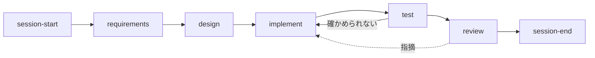

# issue を 1 つやる

工程ごとのスキルを順に呼ぶ。各工程の終わりの関門を通ってから、次へ進む。

| 順 | 工程 | スキル | 型 | 出すもの |
| --- | --- | --- | --- | --- |
| 1 | issue を選ぶ | `session-start` | 手順 | 今回やる issue（In progress、ブランチ） |
| 2 | 要件の確認 | `requirements` | 判断 | 終わりの条件と確かめ方の表 |
| 3 | 設計 | `design` | 判断 | 変えるファイル・データの形・図 |
| 4 | 実装 | `implement` | 手順 | コードとテスト、コミット |
| 5 | テスト | `test` | 手順 | 結果を書いた表 |
| 6 | レビュー | サブエージェント `reviewer` | — | 指摘（いまは中身がないので飛ばす） |
| 7 | まとめ | `session-end` | 手順 | 決めたこと、pull request |

- 工程の途中で人に聞くことが出たら、`.claude/rules/general/autonomy.md` に沿って聞き、答えを待つ間は、それに関わらない工程だけ進める。
- 文書やルールだけの issue でも、工程は飛ばさない。中身が薄くなるだけでよい。
- 関門をすり抜けた問題が見つかったら、どの工程のスキルに決まりを足せば止まったかを考え、pull request の説明に書く。
