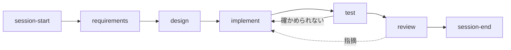

# issue を 1 つやる

工程ごとのスキルを順に呼ぶ。各工程の終わりの関門を通ってから、次へ進む。

| 順 | 工程 | スキル | 型 | 出すもの |
| --- | --- | --- | --- | --- |
| 1 | issue を選ぶ | `session-start` | 手順 | 今回やる issue（In progress、ブランチ） |
| 2 | 要件の確認 | `requirements` | 判断 | 終わりの条件と確かめ方の表 |
| 3 | 設計 | `design` | 判断 | 変えるファイル・データの形・図 |
| 4 | 実装 | `implement` | 手順 | コードとテスト、コミット |
| 5 | テスト | `test` | 手順 | 結果を書いた表 |
| 6 | レビュー | サブエージェント `reviewer` | — | 指摘と、その扱い |
| 7 | まとめ | `session-end` | 手順 | 決めたこと、pull request |

## 6 のレビュー

`reviewer` は、変更をまとめて見る最後の関門です。工程ごとの確かめではありません。本来は工程ごとに別のエージェントが確かめるべきですが、その形はまだありません。いまは、1〜5 の終わりの関門を書いている同じ AI が見ています（`docs/decisions.md` の D48。作るのは qata#59）。

1. テストの関門を通し、変更をコミットしてから、`reviewer` を新しい会話で呼ぶ。渡すのは、リポジトリの場所・比べる元のブランチ・終わりの条件と確かめ方の表・親の場所だけ。なぜそう作ったかは渡さない。リポジトリをまたぐ issue では、リポジトリごとに呼ぶ。`reviewer` がサブエージェントとして読み込まれていないとき（作業フォルダから始めたときなど）は、`.claude/agents/reviewer.md` の本文をそのまま頼みにして、新しいエージェントに渡す。
2. 指摘を一件ずつ読み直し、起きるかを自分でも確かめる。起きないものは、理由を付けて外す。
3. 残ったものを振り分ける。

   | 指摘 | 扱い |
   | --- | --- |
   | 今回の変更で入ったもの | 実装（4）に戻って直し、テストを足す。直したら、テスト（5）を通し直す |
   | 前からあったもの | プロジェクトのルールにある、見つかった不具合の振り分けの基準で、issue か `docs/ideas.md` に置く |

4. 高を直したときは、もう一度 `reviewer` に回す。それ以外は、一回でよい。
5. 指摘の一覧と、それぞれの扱い（直した・外した理由・置いた先）を、pull request の説明に書く。

## ほかの決まり

- 工程の途中で人に聞くことが出たら、`.claude/rules/general/autonomy.md` に沿って聞き、答えを待つ間は、それに関わらない工程だけ進める。
- 文書やルールだけの issue でも、工程は飛ばさない。中身が薄くなるだけでよい。
- 関門をすり抜けた問題が見つかったら、どの工程のスキルに決まりを足せば止まったかを考え、pull request の説明に書く。
