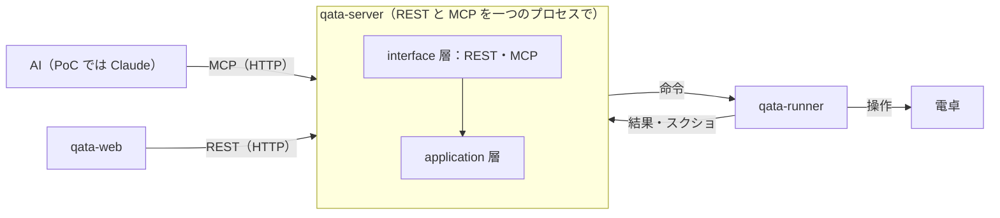

# 構成と境目

## リポジトリ

| リポジトリ | 役割 | 技術 |
| --- | --- | --- |
| `qata`（親） | 目的・中期目標・スコープ・契約・共通の作り方（rules / skills）・ideas | Markdown、JSON Schema |
| `qata-runner` | Windows 上で操作を実行し、結果とスクショを返す | Python、pywinauto、FastAPI、pyright |
| `qata-server` | 部品の辞書の提供、テストケースの検証・登録、実行の指揮、結果の保存。入口は REST と MCP | Python、FastAPI、pydantic、pydantic-settings、MCP の Python SDK（HTTP）、SQLite・SQLAlchemy 2・Alembic、pyright |
| `qata-web` | テストケースの確認・管理、実行、結果の閲覧 | TypeScript、React（Vite）、React Router、TanStack Query、Tailwind CSS・shadcn/ui、ESLint |

- runner と server は、動く場所と依存が違うので分ける。
- **server は LLM を呼ばない。** テストケースを考えるのは MCP の向こうの AI で、server は道具と関門だけを持つ（内製ツールとして、使う環境の AI に考える部分を任せる方針）。
- server の機能は application 層に置き、REST（web 用）と MCP（AI 用）の二つの入口を interface 層に薄く置く。二つの入口は一つのプロセスで動く。

部品のつながり：



## 技術の土台

部品をまたぐ技術の選択です。理由は [decisions.md](decisions.md) の D43 にあります。版の番号は書きません（各部品の lock ファイルが正）。

| 何を | どうする | 部品 |
| --- | --- | --- |
| 言語 | Python（runner・server）、TypeScript（web） | すべて |
| 型の検査 | pyright（Python）、tsc（TypeScript）。どちらも関門に入れる | すべて |
| lint と書式 | ruff（Python）、ESLint と Prettier（TypeScript） | すべて |
| 部品の間の通信 | HTTP。web → server は REST、AI → server は MCP（HTTP）、server → runner は REST | すべて |
| server の入口 | REST と MCP を一つのプロセスで動かす。同じデータを見て、保存に書くのも一つのプロセスにする | server |
| 保存 | SQLite。SQLAlchemy 2 で扱い、表の形の変更は Alembic で記録する。別の DB のサーバーは立てない | server |
| 設定 | 環境変数。Python は pydantic-settings で一か所にまとめる | runner・server |
| ログ | 標準の logging（出し方は別に決める） | runner・server |
| web の見た目 | Tailwind CSS と shadcn/ui | web |
| web の画面と読み込み | React Router（画面を URL で持つ）、TanStack Query（server からの読み込みと読み直し） | web |
| web の入力フォーム | 作る画面ができたときに、React Hook Form と契約の JSON Schema での検証にする | web |
| テスト | pytest（Python）、vitest と Testing Library（web）、Playwright（端から端まで） | すべて |
| 入れないもの | 認証、Redis などの外の待ち行列 | — |

## 子の README に書くこと

部品の中のことは、その部品の README に書きます。土台を変えたら README も直します（design のスキルの基準）。

| 書くこと | 中身 |
| --- | --- |
| 立ち上げ方 | 立ち上げるコマンド、待ち受ける場所、使う環境変数 |
| 関門のコマンド | CI が回すのと同じコマンドと、それぞれが何を確かめるか |
| フォルダと層の分け方 | 主なフォルダと、層と依存の向き |
| 主なライブラリ | 名前と、その部品で何に使うか |
| その部品だけの手順 | 型の生成、マイグレーションの足し方など |

- 選んだ理由は書かず、この文書の「技術の土台」を指す。
- 版の番号は書かない（lock ファイルが正）。

## デモの流れ

1. Claude に日本語で頼む
2. Claude が MCP で部品の辞書を読み、テストケースを作って登録する
3. 実行する
4. 電卓が動く
5. web で結果とスクショを見る

## ローカルのフォルダ

```
作業フォルダ/             ← ただのフォルダ（リポジトリではない）。名前は自由
├── qata/                 ← 親
├── qata-runner/
├── qata-server/
└── qata-web/
```

- 共通のルールや手順は、必ず親リポジトリの中に置く（作業フォルダ直下には置かない）。
- 各部品の CLAUDE.md には「契約と全体の要件は `../qata/` を見る」と書く。

## 境目（契約）

部品の間でやり取りするデータの形を契約とし、親の [contracts/](../contracts/) に JSON Schema で置く。**正は親だけ。** 中身と流れは [contracts/README.md](../contracts/README.md) を見る。

契約には版がある（[contracts/VERSION](../contracts/VERSION)）。子は親のタグからその版の契約を自分のリポジトリに写して持ち、自分の pull request で版を上げるまで、その写しを読む（[repos-and-contracts.md](../.claude/rules/qata/repos-and-contracts.md) の「契約の版」）。親の `main` が進んでも、子の `main` は落ちない。

契約の一覧（PoC の間は仮に確定）：

- テストケースの形式（手順・確認事項）
- 画面の部品の辞書の形式
- runner への命令と、runner からの結果（スクショを含む）
- server の API（親の `openapi.yaml` が正。web はここから型を生成し、server は FastAPI が出す OpenAPI がこれと合うことをテストで確かめる）
- server の MCP の道具（名前・入力・出力）

各部品は契約から型（pydantic / TypeScript）を生成し、生成物もコミットする。生成物が契約と一致しているかをテストで確かめる。

## 未決事項

- `qata` の名前が GitHub / PyPI / npm で使われていないかの確認
- デモで使う MCP のクライアント（Claude Desktop か Claude Code か）
