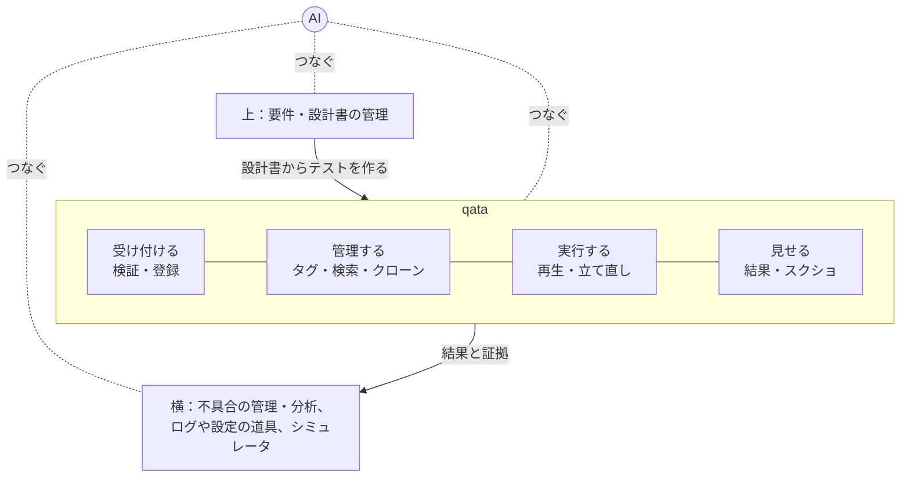
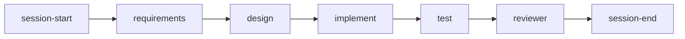
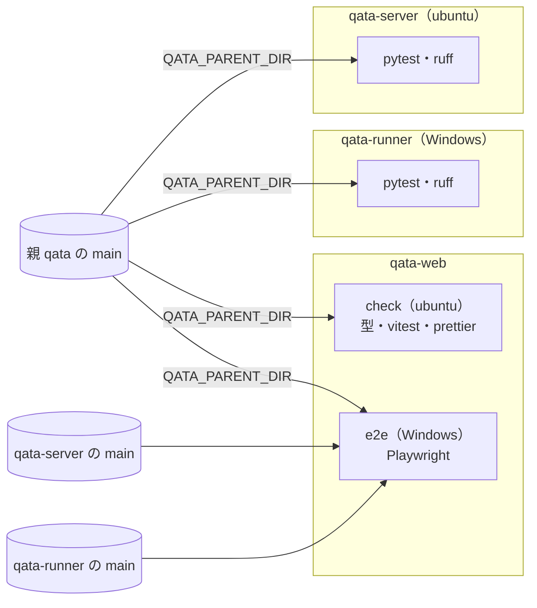

# 決めたこと

AI や人が決めたことと、その理由を残します。人はここをまとめてレビューします。

- **決めた人**：人 / AI
- **レビュー**：済 / 未（AI が決めたものは、人がレビューしたら「済」にする）

新しいものを上に足します。

---

## D54. 子は親のタグから契約を写して持ち、最新の版はタグで知る

- 決めた人：AI　レビュー：未（人のレビューは要らない。困ったら直す。写しの置き場所と道具の名前はあとで変えてよい）
- **版だけを書いて取ってくる形ではなく、契約を写して持つ形にした。** runner と server は、動いている間も契約を読む（結果の判定など）。取ってくる形だと、立ち上げる前に取ってある必要があり、web の CI も e2e のために server と runner の分を取ってくる手順が要る。写して持てば、子のリポジトリだけで読めて動き、ideas の「親を相対のパスで指すのをやめる」の契約の分も満たせる。困るのは同じ写しが三つできることで、写しを手で直していないことを CI で確かめて補う（写し直して差分がないこと。生成した型と同じ確かめ方）。
- **写しは子の直下の `qata-contracts/` に、親の `contracts/` を丸ごと置く。読む版は写しの中の `VERSION`。** 版をほかのファイルに書くと、版と中身がずれうるため。server の生成した型の置き場所（`src/qata_server/contracts/`）と名前が紛れないよう、`contracts/` にはしなかった。
- **写す元は GitHub のタグの tarball。** 隣に並べた親から写すと、親のそのときのブランチの中身を写す誤りが起きうる。タグの tarball なら、その版の中身だけが取れて、親を並べていない CI でも同じに動く。
- **最新の版は、親の `contracts-v*` のタグで知る。** 親の `main` の `contracts/VERSION` は、版を上げた pull request がマージされた直後、タグを付ける前に先に進むことがある。タグはマージして確定した版にだけ付くので、写す元とも合う。`git ls-remote` で、認証も API の回数の制限もなく読める。
- **古いときの警告は、関門を落とさない。** 遅れてよいのは周回の中だけで（D52）、落とすと親の `main` が進むたびに子の `main` が落ちる元の問題に戻るため。タグが取れないときも警告だけにする（つながらないだけで関門を落とさない）。
- **1.0.0 しかない間の確かめは、版を比べる関数のテストにした。** 本物のタグを足さずに、新しい版があるとき・同じとき・数の大小が文字の並びと違うとき（`1.10.0` と `1.9.0`）を確かめられる。
- **汎用のルール（[parent-and-children.md](../.claude/rules/general/parent-and-children.md)）の「子に写さない」を、「手で写さない。写して持つものは正の版から道具で写す」に直した。** 写して持つ形と食い違い、子の作業でどちらに従うかで迷うため（reviewer の指摘）。
- **親の `contracts/` の中から外を指すリンクは、親のリポジトリの URL にした。** 子に丸ごと写すと、相対のリンクが子の中で切れるため。
- **形は三つの子で同じにし、決まりは [repos-and-contracts.md](../.claude/rules/qata/repos-and-contracts.md) の「契約の版」の「子の持ち方」に置いた。** 道具はそれぞれの子の言語で書く（子の CI と関門がその言語で回っているため）。

---

## D53. issue は、立てる前に会話を知らないエージェントに読ませる

- 決めた人：人（issue の前提が端折られてきたという指摘と、決まりにすること）、AI（確かめ方と、本文に書くことの中身）　レビュー：未（AI が決めた部分だけ）
- **人から（2026-11-18）：** issue の内容が、少しずつ前提を端折られてきている。Backlog にしばらく置いたら、何が言いたいか分からなくなりそう。
- **AI が読み直して見つけたこと（qata#69 と sub-issue 三つ）：** いまの読み方（どのファイルが、どこを読んでいるか）が書いていない。落ちる理由がない。言葉の意味がまだマージしていない pull request の中にしかない。子の三つは同じ本文の使い回しで、部品ごとの違いがない。まだ決めていないことに、案の良し悪しがない。
- **確かめは、書いた本人ではなく、会話を知らない別のエージェントにさせる。** 書いた本人は会話の前提を持っているので、抜けに気づけない。工程ごとの確かめを別のエージェントにさせる考え（qata#59）と同じ。本文だけを渡し、「いまどうなっているか・何をするか・なぜやるか・どうなれば終わりか」を説明させ、詰まったところを書き足す。
- **本文に書くことを足した。** いまの状態、決まっていることの理由とリンク、決めていないことの案と良し悪し、終わりの条件の理由、いま開けるリンク、使い回さないこと（[issues.md](../.claude/rules/general/issues.md)）。
- **すでにある Backlog の issue を読み直すのは、別の issue にする（人と相談して決める）。**

---

## D52. 子は読む契約の版を自分で持ち、版の上げ方を決まりにする

- 決めた人：人（版の固定にすること、版の上げ方をしっかり決めること）、AI（版の上げ方の中身・置き場所・issue の分け方）　レビュー：未（AI が決めた部分だけ。困ったら直す）
- **やり方は版の固定。** 後方互換の変更・まとめ用のブランチと比べた（[retro.md](retro.md) の管理の拡張の 1 周目の気づきの 1）。まとめ用のブランチは、壊す変更をそろえて入れたいときの道具として残す。
- **版は三つの数（壊す・足す・説明だけ）。** 読む側が、上がった場所だけで「急いで上げるか」を判断できるため。例だけの変更も三つ目にした。例は子のテストが読むが、形は変わらないため。迷ったら大きいほうを上げる。
- **壊す変更は、足す → 読む側が移る → 古い形を消す の三段に分ける。** 版を固定しても、web の端から端までのテストは server の `main` を動かすので、壊す変更を一度に入れると部品の間でずれる。三段にすれば、どの段でも足すだけになる。
- **読む側が遅れてよいのは周回の中だけ。** 周回の振り返りの前に、すべての子を最新に上げる。上げ忘れを CI の警告と振り返りの二つで拾う。
- **一つ目か二つ目を上げたら、読む側ごとに issue を立てる。三つ目だけなら、次に触るときに上げる。** 説明だけの変更のたびに issue を立てると、定型の手間が増えるため。
- **決まりは汎用（git.md）と固有（repos-and-contracts.md）に分けた。** 版の上げ方は契約に限らない。`contracts/VERSION`・`contracts-v<版>` のタグ・`contracts/CHANGELOG.md` の名前は qata 固有。最初の版は 1.0.0 にする。
- **子の版の持ち方（版だけを書いて取ってくるか、契約を写して持つか）と、最新の版の知り方は、親の qata#69 で三つの子に共通で決める。** 子ごとに決めると形がばらばらになり、誰が決めるのかも二通りに読めるため（issue を会話を知らないエージェントに読ませて分かった、D53）。実行のときも契約を読む runner・server と、e2e で二つを立ち上げる web の事情は、qata#69 の案の比べに書いた。
- **入れる作業は親の issue（[qata#69](https://github.com/masakazu2025/qata/issues/69)）と子の三つの sub-issue。** 親が版を付け、子が一つずつ固定に移る。どの段でもほかの `main` は落ちないので、まとめ用のブランチは要らない。

---

## D51. 管理の拡張の 1 周目の振り返りで、数え方と決まりを直す

- 決めた人：AI　レビュー：未（人のレビューは要らない。数え方は次の振り返りで変えてよい）
- **時間から、セッションの中の 20 分を超える空きを除く。** 2 周目の振り返りで、人から待ち時間を含める意味を問われた。1 周目の範囲を決めたセッションは、質問への答えを 13 時間待ったため、空きを入れると数が意味を持たない。空きを入れた分も表に残す。20 分は、AI が続けて作業しているときの間（数分）より十分長く、人が席を外したと見なせる長さとして置いた。
- **AI の選ぶ形の質問への答えも、人の発言として数える。** 範囲やタグの形のような人の判断は、ほとんどがこの形で出るため。
- **`main` を落とさないことは、git.md の決まりと design の基準にした。** やり方は D52。
- **人に動作を見せることは、requirements の観点にした。** 終わりの条件に入れておけば、作る前にデモ版のデータまで見込める。test や session-end に置くと、作ったあとに気づくことになる。
- **見出しが消える誤りは、implement の手順で止める。** 検査を作ると三つのリポジトリにまたがるので、文書の検査をまとめて入れるときに回した。

---

## D50. タグの細かい形と、絞り込みの引数の名前

- 決めた人：AI　レビュー：未（人のレビューは要らない。2 周目より前なら変えてよい）
- **タグ一つは、1〜100 文字の文字列。並びの中で同じタグは二度書けない（`uniqueItems`）。** 空の文字のタグと重なりは、絞り込みで意味を持たず、書き間違いのことが多いので、形式の検査ではじく。長さの上限は部品の名前（64 文字）より長めにとり、設計書の名前が入るようにした。並びの数の上限は付けない（困ってから付ける）。
- **慣習の区切りは半角の「:」。全角と半角・大文字と小文字・前後の空白は整えず、そのまま別の文字として扱う。絞り込みも文字の完全な一致。** 「機能：加算」と全角で書いたものは「機能:加算」の絞り込みに出ないので、区切りを説明の文に書いた。 整える規則を決めると、server・web・AI のすべてで同じ規則を持つ必要が出るため。ゆれが困るようになったら、必須のタグ（B7）と一緒に考える。
- **`tag`・`tags`・`tag_filter` は共通の部品（`common.schema.json`）に置く。** `tags`（重なりを許さない）はテストケースに付けるもの、`tag_filter`（重なりを許し、一つと見なす）は絞り込みの引数。REST の問い合わせの文字列では重なりを形で禁じにくいので、REST と MCP の両方で「重なりは一つと見なす」にそろえた。空の絞り込みは、指定しないときと同じで絞り込まない（0 件と取り違えないため）。
- **登録で `tags` を省いたものは、記録でも省く。** 空の並びを補うと、登録したものと記録が食い違うため。web は、ないときを空と同じに扱う。
- **REST の引数は `tag` を一つごとに繰り返す（`?tag=a&tag=b`）。MCP の入力は `tags` の並び。** REST は問い合わせの文字列の慣習（FastAPI の `list[str]` の引数もこの形）に、MCP はテストケースの形式の名前に合わせた。どちらも、指定したタグを全部持つもの（AND、D49）を返す。
- **契約の例（登録の例と記録の例）にタグを入れた。** AI が真似する例に、タグの書き方の慣習（「種類:値」）を見せるため。タグなしの形は、例から `tags` を消して確かめる（server の契約の検査に足す、qata-server#22）。
- **例にタグを入れたので、親を先にマージすると、server と web の今の main は、型を作り直すまで関門を通らない。** server は、生成した型が `tags` を知らないので例を読むテストが落ち、REST の引数の突き合わせも `tag` が足りずに落ちる（合わせて 49 件）。web は、生成した型と、デモ版に写した例の二つが落ちる。どちらも qata-server#22・qata-web#22 で作り直せば通る（[git.md](../.claude/rules/general/git.md) の「リポジトリをまたぐとき」の順）。
- **人（2026-11-17）：`main` が落ちてもよいとする考え方はダメ。** 今回は、まだ使う人がいないのでこのまま進める。本来は sub-issue と階層のブランチで、そろってから `main` に入れる。1 周目の振り返りで扱った（D51、[retro.md](retro.md) の管理の拡張の 1 周目の気づきの 1）。

---

## D49. 管理の拡張の 1 周目は、タグと絞り込みだけにする

- 決めた人：人（範囲・タグの形・順番）、AI（issue の分け方）　レビュー：未（AI が決めた部分だけ）
- **範囲はタグ（B2）と、タグでの絞り込み（B4）。** web と MCP の両方で絞り込める。有効な版（B3）とクローン（B5）は 2 周目より後。範囲は [scope.md](scope.md)。
- **タグは文字列の並びにする。** 「機能:加算」のように「種類:値」で書くのは慣習にとどめ、契約では強制しない。絞り込みは、指定したタグを全部持つもの（AND）。あとで種類を必須にする（B7）ときは、「:」の前を読めばよい。種類と値の組で持つ形は、種類の一覧を先に決める必要があるので選ばなかった。
- **登録したあとにタグを直すことは、1 周目に入れない。** web での手直し（A4）と一緒にやる。
- **順番は、ボードの Next（土台の入れ替え）→ 1 周目 → 工程ごとの確かめ（qata#59）。** 別の AI の工程ごとの確かめがまだないので、機能を一度に膨らませない（人）。土台の入れ替えは、端から端までのテストが前後で同じように通ることを確かめにする。
- **issue は契約（親）・server・web の三つに分ける。** 正を持つ契約を先にし、server と web はそれを読む（[git.md](../.claude/rules/general/git.md) の「リポジトリをまたぐとき」）。

## D48. 別の AI のレビューを、issue の流れの中で毎回回す

- 決めた人：人（工程ごとの確かめの意図と、最初の一歩としてこの形でよいこと）、AI（ほかのすべて）　レビュー：未（AI が決めた部分だけ。人のレビューは要らない。観点と出し方は、使いながら変えてよい）
- **この reviewer は、人の意図とは違う（人、2026-11-16）。** 人の意図は、工程（要件・設計・実装・テスト）ごとの確かめを、工程ごとに別のエージェントが行うこと。工程をスキルに分けたのは、そのためでもある。この reviewer は、変更をまとめて見る最後の関門で、工程ごとの確かめではない。いまの工程ごとの確かめは、各スキルの「終わりの関門」を、書いている同じ AI が見ているだけ。最初の一歩として、前回のレビューを整理したこの形でよしとした。工程ごとのエージェントは [qata#59](https://github.com/masakazu2025/qata/issues/59) で作る。
- **観点は 7 つ。** 前回のレビュー（[reviews/2026-11-15.md](reviews/2026-11-15.md) の「全体の傾向」）の 5 つの傾向に、ideas に置いていた 3 つ（関門のテストが、わざと壊したコードを捕まえるか・生成した型を手で書いた型が上書きしないか・ルールとスキルが食い違っていないか）を合わせた。「判定の条件」（観点 2）は、一覧の 4（前準備が失敗しても合格になる）から独立させた。合否を誤る不具合は一番困るので、契約との突き合わせの中に埋めないため。型や書き方の誤りは関門が拾うので外した。中身は [reviewer.md](../.claude/agents/reviewer.md)。
- **観点の例と問いには、前回の一覧で実際に出たものだけを使う。** 試しで入れる不具合の言い回しが観点にあると、答えを教えることになり、効くかを確かめられないため。最初の版は、観点 2 の問いに試しの答え（「等しい／含む」）が入っていた。この issue の変更を reviewer に回して見つかったので、外した。試しで効き目を確かめるときは、入れる不具合の言い回しで reviewer.md を grep し、当たらないことを確かめてから回す。
- **指摘には「結果を誤らせるか」「普通に使って起きるか」を付けさせる。** 振り分けの基準（[findings.md](../.claude/rules/qata/findings.md)）の二つの問いなので、書いた側が機械的に振り分けられる。重さもこの二つから決める。
- **渡すのは、場所・比べる元・終わりの条件・親の場所だけ。** 作った理由は渡さない。書いた側の思い込みを渡さないため（D44 と同じ）。
- **書いた側が、指摘を確かめ直してから振り分ける。** 今回の変更で入ったものは直し、前からあったものは振り分けの基準に回す。もう一度回すのは高を直したときだけ。毎回回し直すと、終わりが決まらないため。
- **作業フォルダから始めると、reviewer がサブエージェントとして読み込まれない。** そのときは reviewer.md の本文を頼みにして新しいエージェントに渡す、と work-issue に書いた。
- **reviewer.md は、汎用と固有に分けていない。** 観点が qata の部品と道具（pyright・契約）に寄っているが、置き場所の決まり（[rules-and-skills.md](../.claude/rules/general/rules-and-skills.md)）はルールとスキルだけで、サブエージェントの分け方はない。ほかのプロジェクトで使うときに分ける。
- **文書やルールだけの変更では、観点 7 だけを見る。** 観点 6（偽の相手）は文書には当たらないため。
- **効くかは、qata-server の使い捨てのブランチで、2 回確かめた。** 1 回目は関門を通る不具合を 2 つ（期待する値との比べ方を「一致」から「含む」に変える、合否を見ないテストを足す）。観点の問いが答えを言い当てていたので、2 回目は問いに書いていない種類（壊れた結果の検査の一つを、読みやすくする体裁で外す）にした。結果は qata#47 の pull request に書いた。

---

## D47. 想定していない誤りも、契約の形（`internal_error`）で返す

- 決めた人：AI　レビュー：未（人のレビューは要らない。コードの名前と返し方はあとで変えてよい）
- **コードは `internal_error`。** REST は 500、MCP は isError の結果で、どちらも error_response の形。画面も AI も、ほかのエラーと同じ読み方で理由が分かる。
- **openapi.yaml では、すべての道に 500 を書いた。** 共通の応答 `internal_error` を components に置き、各道から指す。web の生成する型にエラーの形が出て、server の照合テストで「全部の道で 500 を返せる」ことも確かめられる。mcp-tools.json と契約の README には説明の文を足した。
- **message には例外の種類だけを入れる。** 中身（パスや値）は利用者に見せない。詳しいことは server のログに残す（REST は Starlette が投げ直してログに出る、MCP は server が書く）。ログの出し方は qata#48 で決め直してよい。
- **極端に深く入れ子にした本文は、500 ではなく「読めない本文」として扱う。** JSON として読めない本文と同じく、形式の誤り（検証の結果）で返す。送った側の誤りなので、server の誤りとは分けた。
- **画面に出る文言は、テスターも読める形にする（人の指摘、2026-11-15）。** 何が起きたかを先に書き（することがあれば、それも）、契約の言葉や例外の種類は「詳しく」やかっこの中に入れる。今回は `invalid_runner_result` と `internal_error` の二つだけを直し、ほかの文言は [qata#57](https://github.com/masakazu2025/qata/issues/57) で見直す。
- **スクショのデータが読めないときは、`ValueError` もまとめて `invalid_runner_result` にする。** ASCII でない文字があると、`binascii.Error` ではない `ValueError` が出るため。

## D46. 実行が重なったら、runner は待たずに断り、server は結果を残さずに伝える

- 決めた人：人（runner で守り、409 で断る）、AI（ほかのすべて）　レビュー：未（AI が決めた部分だけ。人のレビューは要らない）
- **runner で守る（人、D45）。** 画面を持っているのは runner なので、server が何台あっても守れる。
- **待たずに断る（AI）。** 待たせて順に流すと、server が待つのをやめた（300 秒）あとに動き出し、次の実行と重なる。断れば、人や AI が終わってからもう一度実行すればよい。
- **コードは `runner_busy`（AI）。** runner の 409 の本文は、ほかの runner のエラーと同じ共通の部品 `error`。server は REST の 409・MCP のエラーで、同じ `runner_busy` を返す。runner の都合だが、利用者がすることは「あとでもう一度」で、ほかの 409（確認待ち・辞書に合わない）と同じ種類なので、502（届かない）とは分けた。
- **server は、409 で `runner_busy` のときだけ見分ける（AI）。** それ以外の runner の HTTP のエラーは、いままでどおり「届かない」（502）。実行していないので、実行の結果は残さない。
- **契約には、説明の文だけを足した（AI）。** runner の HTTP のエラーは JSON Schema にしていない（いまの `invalid_command` と同じ扱い）。形が増えたら考える。
- **web は型を生成し直しただけ（AI）。** 画面は server のエラーの message を出すので、変えていない。

---

## D45. 見つかった不具合は、人が決めた基準で AI が振り分ける

- 決めた人：人（高の扱い・基準・テストの抜けの扱い）、AI（まとめ方と並び）　レビュー：未（AI が決めた部分だけ。人のレビューは要らない）
- **高。** 別の AI のレビュー（D44）で重さが高だった 3 件は、すべて直す（人）。実行が重なるもの（一覧の 1）は、runner が一度に一つしか受け付けず、重なったら 409 で断る。画面を持つのは runner なので、server が何台あっても守れる（人）。高の 3 件は、土台を固める issue（D43）より先にやる。小さくて土台とぶつからず、結果を誤らせる問題を早く消せる（人）。
- **基準。** 中・低は、一件ずつ人が決めるのではなく、人は基準だけを決め、AI が当てはめる（人）。人が細かいところまで判断しなくても、課題を消化できるようにするため。基準は「テストの結果を誤らせるか、人が普通に使って起きるか」。はいなら issue、いいえなら ideas.md に置き、その場所を触るときに直す。決まりは [findings.md](../.claude/rules/qata/findings.md) に置いた。
- **テストの抜け。** 抜けだけを別扱いにはせず、抜けの先で起きうる不具合に同じ基準を当てる（人）。「触るときに足す」だけだと、誤った結果を残す場所の抜けが、誰も触らないまま残る。今回も、テストの抜け（一覧の 10）から不具合（一覧の 3）が漏れていた。
- **まとめ方と並び（AI）。** 近い場所のものを一つの issue にまとめた（中で 5 つ）。Backlog に、テストの結果を誤らせるものから並べた。Next に上げるのは人。web の 2 つは、画面の作りが変わる qata-web#12 のあとにやる。
- **issues.md。** AI が issue を立ててよいときに、「人が決めた振り分けの基準に当てはまるとき」を足した。

---

## D44. 別の AI のレビューは、部品ごとに経緯を渡さずに回し、一覧を親に一つ置く

- 決めた人：AI　レビュー：未（人のレビューは要らない。やり方は qata#47 で変えてよい）
- **回し方。** 部品ごとに一つ、経緯を渡さない新しい会話の AI に読ませた。渡したのはリポジトリの場所・契約・architecture.md と、探すもの（型や書き方の誤りを除いた、不具合・テストの抜け・契約との食い違い・設計のずれ）だけ。書いた AI の思い込みを渡さないため。指摘には「確かめた／読んだだけ」を付けさせ、重さが高のものは書いた側も読み直して確かめた。推測だけの指摘を残さないため。
- **置き場所。** 一覧は子のリポジトリではなく、親の [reviews/2026-11-15.md](reviews/2026-11-15.md) に一つにした。次の qata#47 が三つを並べて観点を決めるので、一か所にあるほうが比べやすい。部品をまたぐ指摘（同時の実行）もあるため。レビューは周回ごとに増えるので、`docs/reviews/` に日付の名前で置く（人）。
- **書き方。** 一つのファイルに、上から「前提（部品のつながりの図と役目）」「一覧の表」「一件ずつの説明」を置く（人）。一覧の表は、番号・重さ・部品・何が起きるかの一言だけにし、番号から説明に飛べるようにする。表の欄に説明を詰め込むと、ソースを読んでいない人には読めないため（人）。説明は、ソースを読んでいなくても分かる文で「何が起きて、何が困るか」を書き、その下に AI のための短い行（場所・確かめ方・防げたもの）と、一覧に戻るリンクを置く（人）。人のための要約と AI のための詳細には分けない。番号や中身を一か所で直せて、ずれないため（AI）。部品をまたいで同じことが起きているものは一件にまとめ、部品の列に並べる。並びは重い順にする。直す順を決めるときに見やすいため（AI）。困ることが小さいものは、説明を短くしてよい（AI）。リンクは Markdown の記法だけで書き、飛び先は見出しにする。HTML の `<a id>` は、人が使う WYSIWYG の editor では飛び先にならないため（人）。飛び先にする見出しには句読点を入れない。句読点の扱いは editor と GitHub で違い、入れると飛び先の名前がずれるため（AI）。
- **外したもの。** D43 で入れると決めて、まだ入れていないだけのもの（issue があるもの）は、指摘から外して末尾に並べた。直すことが決まっているものを、見落としとして数えないため。
- **直すこと。** 見つかったものは issue にせず、[ideas.md](ideas.md) に置いた。AI は issue を自分の判断で立てない（`issues.md`）。

---

## D43. 管理の拡張の前に、フロントとバックエンドの土台を固める

- 決めた人：人（理由の書き方・README に書くこと・design の基準は AI）　レビュー：未（AI が決めた部分だけ。人のレビューは要らない）
- **いつ。** 管理の拡張（テストケースのタグ・検索・まとめて流すなど）を作る前に入れる。画面と表が増えてから入れ替えると、直す量が増えるため（人）。
- **web。**
  - 見た目は Tailwind CSS と shadcn/ui。画面が増えても見た目がそろい、部品のソースを手元に持つので直しやすい。
  - 画面の切り替えは React Router。一覧・詳細などを URL で持ち、開き直しても同じ画面に戻れるようにする。
  - server からの読み込みは TanStack Query。いまの「3 秒ごとに読み直す」や、変えたあとの読み直しを、画面ごとに書かずに済ませる。
  - 関門に ESLint を足す。型と書式で止まらない誤りを、機械で止める。
  - テストは vitest・Testing Library・Playwright のまま。
  - 入力フォームは、作る画面ができたときに React Hook Form と、契約の JSON Schema での検証にする。検証の正を契約にそろえるため。いまは作る画面がないので入れない（YAGNI）。
- **server。**
  - 保存は SQLite のまま、SQLAlchemy 2 と Alembic にする。管理の拡張で表の形が変わるので、形の変え方を記録して、手元のデータを残したまま変えられるようにする。手元で使う内製ツールなので、別の DB のサーバーは立てない。
  - 設定は pydantic-settings に一か所にまとめる。環境変数の読み取りが散らばらないようにする。
  - ログは標準の logging。外の依存を足さない。出し方は別に決める（qata#48）。
  - MCP を HTTP にして、REST と同じプロセスで動かす。いまは stdio の MCP と REST が別のプロセスで、同じデータを見るには保存先を合わせる必要がある。一つのプロセスなら、同じデータを見て、SQLite に書くのも一つのプロセスになる。
- **runner と server。** 関門に pyright（型の静的解析）を足す。AI が書いたコードの型の誤りを、機械で止める。
- **入れないもの。** 認証（手元で使う内製ツールで、外に出さない）。Redis などの外の待ち行列（実行は一つずつで、プロセスの中で足りる）。
- **書く場所。** 部品をまたぐ選択とその理由は [architecture.md](architecture.md) の「技術の土台」に置き、版の番号は書かない（lock ファイルが正）。部品の中のこと（立ち上げ方・関門のコマンド・層の分け方・主なライブラリ・その部品だけの手順）は子の README に書き、選んだ理由は書かずに architecture.md を指す（AI）。同じことを二か所に書かないため。
- **design の基準。** [design のスキル](../.claude/skills/design/SKILL.md)の基準に「土台」を足し、土台を変えるときに README（と、部品をまたぐなら architecture.md）を直すようにした（AI）。README が実際とずれるのを、設計の段で止めるため。

## D42. 中期目標は、やることの大きなまとまりを順番なしで並べる。業務アプリの性質は自作の練習台で確かめる

- 決めた人：人（案は AI）　レビュー：済
- **まとまり。** [roadmap.md](roadmap.md) に四つのまとまりを置いた：管理の拡張・手順の表現の拡張・業務アプリでのテスト・運用の拡張。それぞれに、届いたと言える状態を付けた。順番は付けない。
- **スコープ。** いまやるまとまりを [scope.md](scope.md) に置き、中身はやるときに吟味する。やらなかったものはあとに回す。いまは管理の拡張。途中で別のまとまりに移ることもあるので、決まりは厳密にしない（人）。
- 一度は、まとまりを段階として順に並べる案を作ったが、採らなかった。一つを作り込んでから次へ進むと、あとで形式（契約）がおかしいと分かったときの戻りが大きく、業務アプリの性質に当たるのも遅くなるため（人）。「軸」「周回」で組み立てる案も、言葉が増えるだけなので採らなかった（人）。
- 起動し直さずに流すこと（C8〜C11）は難しいので、後回しにする（人）。
- **練習台。** vision の「業務アプリの性質を持つアプリで、これが回る」は、業務アプリの性質（[app-traits.md](knowledge/app-traits.md)）だけを真似た小さな Windows アプリを自作して確かめる。公開するリポジトリに置き、現場のアプリの名前や中身は入れない。
- まとまりは、機能を棚卸ししてから決めた（[roadmap.md](roadmap.md) の付録）。棚卸しの前に出した案は採らなかった（人）。
- 理由：現場の知識は公開しない（D28）ので、公開するリポジトリで再現できる対象が要る。

## D41. このプロジェクトのゴールは E2E のモジュールの完成にし、vision と中期目標を分けて持つ

- 決めた人：人（案は AI）　レビュー：未（「届いたと言える状態」の中身は人が確かめる）
- **ゴール。** このプロジェクトのゴールは、E2E のテストを作成・実行・管理するモジュールの完成にする。QA の活動を AI で支える仕組みの全体（入口・Agent の層・道具の層）は、ゴールではなく位置づけとして [vision.md](vision.md) に書く。このモジュールは、その道具の層の一つ。
- **層の分け方（仮）。** Agent の層は判断をし、Agent・スキルの定義で、機能ごとに分ける（要件の不足の指摘も Agent の層）。道具の層は判断せず、ソースを持つ独立したプロジェクトにする。D39 の「判断は外、道具は判断しない」を、層の分け方にしたもの。
- **範囲が狭くなったもの。** D39 で qata の「切り出す道具」「周辺」に置いていた設定・ログの道具とシミュレータは、このモジュールの範囲の外にし、別の道具として扱う（人）。
- **文書の分け方。**

| 文書 | 中身 | 変わる速さ |
| --- | --- | --- |
| [vision.md](vision.md) | 目標・届いたと言える状態・位置づけ・範囲・対象・使われ方 | ほとんど変えない |
| `roadmap.md`（中期目標、qata#42 で作る） | vision に向かう段階と、各段階の完了の条件（一文） | 段階が終わるたびに見直す |
| [scope.md](scope.md) | いまの段階の範囲（やる・やらない） | 段階ごとに書き直す |

- 段階は、期間ではなく、できること（「何を見せられたら終わりか」）で区切る。個人の OSS で期限がないため。
- **決めていないこと。** 製品の Agent の分け方と置き場所は [ideas.md](ideas.md) に置く。
- 理由：ゴールを E2E のモジュールにすると、具体的になって段階に分けやすい。遠くの姿と途中の段階は変わる速さが違うので、同じ文書に置くと、段階を見直すたびに vision まで書き換えることになる（人）。

## D40. リポジトリをまたぐ変更は、正を持つほうを先にマージする（暫定）

- 決めた人：人（案は AI）　レビュー：済
- 1 つの issue で親と子の両方に PR が要るときは、親を先にマージし、子の CI を回し直してから子をマージする（[git.md](../.claude/rules/general/git.md) の「リポジトリをまたぐとき」）。子の CI は親の main の契約を読むので、逆の順では通らない。
- 作り直すだけのような小さな追従は、子の issue を立てず、親の issue を指す PR だけにする（[parent-and-children.md](../.claude/rules/general/parent-and-children.md)）。
- design の基準に「正から生成したり写したりしているものも直す（説明だけの変更でも）」を、test に「説明の文だけの変更なら e2e は回さない」を足した。
- 暫定にした理由：本来は、子が親の更新を見て自分で追いつくのがよい（人）。いまは親のセッションが号令を掛けて子を動かしているので、この形にした（[ideas.md](ideas.md)）。
- きっかけ：#36 を #33 の流れで通したとき、契約の説明の文を変えただけで web の型の生成物が変わり、web の CI が落ちた（#38）。

## D39. qata の範囲は「受け付ける・管理する・実行する・見せる」まで。判断は外で行い、道具は判断しない

- 決めた人：人　レビュー：済
- 機能のブレスト（[qata#34](https://github.com/masakazu2025/qata/issues/34)）から決めた。全体の図は [vision.md](vision.md)。

- **qata の範囲。** テストを受け付けて、管理して、実行して、結果を見せるところまで。テストの中身を考えるのは外（AI か人）で、qata は受け付けて検証・登録する（いまの設計と同じ）。不具合の報告を書くのも外で、qata は結果と証拠を引用しやすい形で渡す。
- **判断は外、道具は判断しない。** server が LLM を呼ばない（[architecture.md](architecture.md)）のと同じ考えを、全体に広げる。ログの解析や、次に何をするかの判断は外（AI）で行う。
- **runner にはできるだけ入れない。** runner は画面を操作する・確かめる・スクショを撮るだけ。外で間に合わないと分かったときだけ、理由を残して入れる。
  - 例：「ログにこの行が出るまで待つ」は、まずテストを二つに分け、その間で AI がログの道具を使って確かめる形で作る。
- **中身と置き方を分ける。** ログや設定の道具は、runner に頼らない独立したモジュールとして作る。端末で単独に動かすか、runner に組み込むかは、現場の制約が見えてから決める（対象の端末で動く必要があるため）。
- 理由：難しさの多くは runner（画面の部品の情報が取れない、立て直しが画面の操作になる）に集まる。判断まで道具に入れると、道具ごとに AI を呼ぶことになり、使う環境の AI に考える部分を任せる方針（[architecture.md](architecture.md)）と食い違う。

## D38. issue を 1 つやる流れを、工程ごとのスキルに分ける

- 決めた人：AI　レビュー：未（人のレビューは要らない。名前と分け方はあとで変えてよい）

- `work-issue` が工程を順に呼ぶ。工程は `requirements`・`design`（判断の型：観点と基準の表）と `implement`・`test`（手順型）。どれも「入力・出すもの・終わりの関門」だけの薄いもの。すべて汎用に置いた（プロジェクトの名前を書いていない）。
- 工程の間を渡すものは、「終わりの条件と確かめ方の表」一つにした。要件の確認で作り、テストで結果を書き、pull request の説明に写す。
- レビューはサブエージェント `reviewer`（`.claude/agents/`）として名前だけ置き、中身は #23 のあとで入れる。それまでは飛ばす。サブエージェントの置き場所を `rules-and-skills.md` の表に足した。
- 「つぎ」の入口は session-start のままにし、その最後から work-issue の 2 に続ける。入口を二つにすると、どちらを読むかで迷う。
- 理由：工程ごとに箱があれば、すり抜けが見つかったときに、どの工程に決まりを足せばよいかがはっきりする（#33）。

## D37. ルールとスキルは、いまは子から親を読む形のまま続ける

- 決めた人：人　レビュー：済
- プラグイン（ルールやスキルを、GitHub のリポジトリから取り込む仕組み）で子に配れるかを調べた（[qata#31](https://github.com/masakazu2025/qata/issues/31)）。スキルは配れるが、ルールは配れず、clone した人が各自で入れる手間があり、クラウドで動く AI には入らない。
- いまは D24 の形（子の CLAUDE.md から `../qata/` で親を読む）を続け、子を分けて持つのはいずれやる（[ideas.md](ideas.md)）。
- 理由：プラグインにするには、作って試す手間が大きい。いまは子を担当するのが同じ人と AI なので、困っていない。

## D36. issue には背景を書き、経緯を知らない人が読んで分かるようにする

- 決めた人：人　レビュー：済
- issue の雛形に「背景」（なぜやるのか）と「関連」を足し、「メモ」をやめた。タイトルだけで何をするかが分かるようにし、内輪の言葉や番号は説明なしで使わない（[issues.md](../.claude/rules/general/issues.md)）。
- それまでの issue（qata#21〜#25）も、この形で書き直した。
- 理由：出先で issue を読んだら、やることと終わりの条件だけでは唐突で、何を言っているか分からなかった。

## D35. やることは GitHub の issue とボードで持つ

- 決めた人：人　レビュー：済
- やることは `docs/tasks.md` ではなく、GitHub の issue に置く。一つの部品で閉じるものはそのリポジトリ、部品をまたぐものと全体の判断は親。優先順は GitHub Projects のボードの並び順で持つ。使い方は [issues.md](../.claude/rules/general/issues.md)。
- issue にするのは、やると決めて、終わりの条件が書けて、すぐ手をつけられるものだけ。まだ決めていないものは ideas.md に置き、issue に上げたら ideas.md から消す。
- ラベルは `background`（裏で回してよい）と `needs-desktop`（実機が要る）の二つだけで始める。優先度のラベルは作らない。
- `docs/tasks.md`・`docs/issues.md`・`docs/log.md` はやめる。やったことは pull request に残す。それまでの log.md は、各リポジトリの閉じた issue に転記した（qata#20・qata-runner#6・qata-server#8・qata-web#7）。親の tasks.md の中身は qata#21〜#25 にした。
- 理由：小さな作業を、何かをしながら裏で少しずつ回したい。そのためには、作業の単位が終わりの条件つきで外から読める形になっていて、PR とつながっている必要がある。tasks.md にリンクだけ並べる案は、二重管理になるのでやめた。

## D34. 次の周回は、振り返りと QA だけで回す

- 決めた人：人　レビュー：済
- デモが完了したので、次の周回は新しいものを作らず、2 周目の振り返りと QA（触って探す・別の目で見る）をやる。書き方を縛るもの（規約・パターン・雛形）も、QA で見つかったことから決める。
- 理由：2 周目は実装を急いだ。関門は、それを書いた AI が思いついたことしか見ていない。デモの記録を見て初めて気づいたこと（`needs_review` を AI が埋める）もあった。

## D33. CI の最低限の形

- 決めた人：AI　レビュー：未（人のレビューは要らない。PoC が終わったときにまとめて振り返る、D25）

| 部品 | ジョブ（必須のチェック） | 実行環境 | 回すもの |
| --- | --- | --- | --- |
| qata-server | `test` | ubuntu | `uv run pytest`・`ruff check`・`ruff format --check` |
| qata-runner | `test` | Windows | 同じ |
| qata-web | `check` | ubuntu | `npm run check` |
| qata-web | `e2e` | Windows | `npm run e2e`（隣に qata-server・qata-runner の main） |

- 各部品の `.github/workflows/ci.yml`。pull request と main への push で回す。
- 親の場所は、環境変数 `QATA_PARENT_DIR` で親のリポジトリを指す。指していなければ、いまどおり `../qata`。CI では親を `parent/` という名前で取ってきて、環境変数が効いていることも確かめる（`../qata` には何もない）。
- server は依存が OS によらないので ubuntu（速い）。runner と、runner を立ち上げる web の e2e は Windows（runner は Windows で動く）。
- ブランチの保護は、main で上のチェックが通ることを必須にし、管理者にも効かせる。レビューの承認は必須にしない（マージの前の人の一言は、セッションの中で続ける）。
- 部品をまたぐ変更は、web の e2e が server・runner の main を使うので、server・runner を先にマージする。
- 理由：tasks.md の「CI を最低限で入れる」（D30）。速さと、runner が Windows で動くことの兼ね合い。

## D32. 現場の知識を書くか判断がつかないときは、人に聞く

- 決めた人：人　レビュー：済
- 「この文から、特定の業務や製品が分かるか」で判断がつかなければ、人に聞く。AI が自分で判断しきらない。
- 業務の知識はセキュリティに関わるものとして慎重に扱う。一つずつは一般的でも、組み合わせると分かることがあるので、性質を並べるときも気をつける（AI が足した）。
- ルールは [knowledge.md](../.claude/rules/qata/knowledge.md)。D2・D21 の「細かいことは AI が決める」の例外。
- 理由：書いてしまうと公開され、取り消しにくい（[autonomy.md](../.claude/rules/general/autonomy.md) の「取り消しにくいこと、外に出ること」にあたる）。

## D31. 現場の知識は docs/knowledge/ に、四つのファイルで積み上げる

- 決めた人：AI　レビュー：未（中身は人が確かめる。ユースケースの U2・U3 は案）
- 置き場所は親の [docs/knowledge/](knowledge/)。用語集・業務アプリの性質・自動化で困ること・想定するユースケースの四つに分けた。入口の README に、decisions・ideas との違いを図で置いた。
- 知識（分かったこと）は knowledge に書き、decisions（決めたこと）と ideas（改善案）からはリンクで指す。ideas にあった同時押し・読み方・立て直しの知識は、knowledge に移した。decisions は記録なので書き換えない。
- 言葉は用語集に合わせ、新しく使い始めたら足す（[knowledge.md](../.claude/rules/qata/knowledge.md)）。人から出た知識は、セッションの終わりに一般化して書く（[session-end](../.claude/skills/session-end/SKILL.md) の 5）。
- 子の CLAUDE.md にも knowledge.md を読み込ませた。
- 理由：ideas は使ったら消え、decisions は理由の記録なので、どちらも知識を積み上げる場所にならない（最初の周回の振り返り）。

## D30. 次の周回は、デモの完了を先にし、土台の直しは最低限にする

- 決めた人：人　レビュー：済
- 順番：現場の知識の層の箱 → CI（最低限） → Vercel でデモ版の web → 偽物を本物に置き換えてデモを完了 → 書き方を縛るもの。
- Vercel のデモ版は、ブラウザの中に偽の server を入れる形にする（関数や、server をクラウドに置く形より軽い。AI の案を人が採った）。本物に置き換えたあとも、人に見せる入口として偽の server のまま残す。中身は [tasks.md](tasks.md)。
- CI の最低限は、いまのテストを回して通らないとマージできないようにするだけ。親の契約は、CI で親のリポジトリを丸ごと取ってきて読む。子が使うものだけを写して要らないものを外すのは、デモのあと。
- 親と子の関係のルール、相対のパスをやめること、AI のレビューは、デモのあとに本格的に取り組む（[ideas.md](ideas.md)）。
- 理由：土台の直しは難しく、気合を入れると重くなる。PoC の目的はデモの完了なので、先にそこまで通す。

## D29. 人に見せるものは表と図を先に出し、構造は構想に関わるものだけ人と決める

- 決めた人：人　レビュー：済
- 人に見せるもの（報告・質問・設計の説明）は、表と図を先に出し、文章は補足にする。図は Mermaid で書き、文書の中に持つ（GitHub と VS Code のプレビューで見られる）。
- 機能を足して構造が変わるとき（並ぶ操作が増える、横でつながるなど）は、AI が影響を整理して図にし、構造の案を出す。人に聞くのは、この先の構想に関わる構造だけ。影響を見たあとの判断を、すべて人に回すことはしない。
- コードの中身は、明らかな問題がなければ人は見ない。確かさは、上位から作ったテストと、規約・パターン・技術のレビューで押さえる（規約などは次の周回から、[ideas.md](ideas.md)）。人が持つのは、仕様の切り方・ユースケース・文書の管理と、シーケンス図やロジックの構造の図。
- ルールは [autonomy.md](../.claude/rules/general/autonomy.md)。
- 理由：最初の周回の振り返りで、文章が多いと人の負担が大きいことと、構造は構想を持つ人が決めたほうが、この先にとってよいものになることが分かった。

## D28. 現場の知識は公開しない。一般化できるものだけ文書に書く

- 決めた人：人　レビュー：済
- 自動化の一般論（Windows アプリ・Web）と、業務アプリ全般に共通することは、積極的に書く。
- 特定の業務（POS など）に固有のことは、説明のためにチャットで話しても、文書には残さない。汎用性が保たれる形に一般化できるもの（「起動し直せない業務アプリ」など）だけ、「こういうユースケースも想定する」として書く。
- いまの文書にあった POS の話は、一般化した言い方に直した。git の履歴は書き換えない（強制の push はしない、[git.md](../.claude/rules/general/git.md)）。README と vision の対象は「店舗などで使う業務端末」にした。
- ルールは [knowledge.md](../.claude/rules/qata/knowledge.md)。
- 理由：リポジトリは公開する。現場の知識は公開しない。

## D27. 振り返りは retro.md に置き、人の発言を 4 つに分けて数える

- 決めた人：AI　レビュー：未（人のレビューは要らない。分け方はあとで変えてよい）
- 置き場所は [retro.md](retro.md)（D3 で、最初の周回が終わったら作ると決めていた）。周回ごとに上に足す。
- 時間と人の発言は、Claude Code のセッションの記録から集める。人の発言は「直した・決めた・聞いた・定型」に分け、「直した」が減っていくことを指標にする。
- 理由：「口を出した回数」をそのまま数えると、マージの許可や技術の質問も混ざり、仕組みが育ったかどうかが見えない。人が決めるもの（対象の業務アプリの前提など）は、減らすものではない。

## D26. 端から端までのテストは qata-web に置き、偽物を置き換えるときの関門にする

- 決めた人：AI　レビュー：未（人のレビューは要らない。PoC が終わったときにまとめて振り返る、D25）
- 親にはコードを置かない（D22）ので、人に見せる側の端である qata-web に置いた（`npm run e2e`、Playwright。細部は qata-web の W3）。
- 隣に並べた qata-runner・qata-server と web を立ち上げ、AI の代わりに MCP のクライアントで登録し、web で承認・実行して、結果とスクショを見る。
- [process.md](process.md) の「順番」の 3 で偽物を本物に置き換えるときは、これが通り続けることを関門にする。
- 隣のリポジトリを相対のパスで指すのは、ほかと同じ（[ideas.md](ideas.md) の「相対のパスをやめる」とまとめて直す）。

## D25. あとから変えられることは、セッションの終わりにレビューを頼まない

- 決めた人：人　レビュー：済
- `session-end` の報告で、「レビュー：未」で足したものすべてにレビューを頼んでいた。D21・D23 と食い違うので、聞くのは [autonomy.md](../.claude/rules/general/autonomy.md) で人に聞くと決めたものだけにした。
- AI が決めた、あとから変えられることは「レビュー：未（人のレビューは要らない）」で残し、PoC が終わったときにまとめて振り返る（D23）。
- 理由：qata-server の S3〜S5（server の中だけのこと）にレビューを頼み、人に「PoC なのに、人が決めなければならないのか」と指摘された。

## D24. 子が親のルールとスキルを読む方法

- 決めた人：AI　レビュー：済（PoC の間はこれでよい。次の周回で見直す、[ideas.md](ideas.md)）
- D7 で「部品を作るときに決める」としていたもの。子の CLAUDE.md から、親のルールを `@../qata/.claude/rules/...` で読み込む。スキルは、子の CLAUDE.md に親の `SKILL.md` の場所を書いて、それに沿う。
- 理由：子に写さずに済み、親を直せばすべての子に効く。Claude Code は CLAUDE.md の `@パス` を読み込むが、親の `.claude/rules/` は子から自動では読まない。
- 子のリポジトリは、作った最初から `.gitattributes` で改行を LF にそろえる（親は [ideas.md](ideas.md) のまま）。

## D23. Git の決まり

- 決めた人：人（GitHub Flow、pull request、1 タスク 1 セッション 1 コミット以上）・AI（細部）　レビュー：済
- GitHub Flow。`main` に直接コミットせず、タスクごとに `<種類>/<内容>` のブランチを切り、pull request で `main` に入れる。1 セッションに少なくとも 1 コミットし、要るときは分ける。ルールは [git.md](../.claude/rules/general/git.md)。
- PoC の間は、マージは AI がしてよい。中身は人がセッションの中で見ているので、pull request は記録として残す。
- 理由：これまで `main` に直接コミットしていたが、決まりがなかった。gitflow の `develop`・`release` は、版を決めて出すものがない今は手間が増えるだけ。版が要るようになったら（内製に派生させるときなど）見直す。
- AI が仮に決めたことで問題が出たら、PoC が終わったときにまとめて振り返る（人）。[process.md](process.md) の振り返りの項目に足した。

## D22. 契約の検査は部品の側に置き、親にはコードを置かない

- 決めた人：人（親は判断とプロジェクト管理に寄せる）・AI（置き場所）　レビュー：済
- 親には契約の文書だけを置き、検査のコードは置かない。最初は親に置く案だったが、親の規模が大きくなるので取りやめた。
- 契約の検査（例が形式に通る・間違った例をはじく・ファイルの間の `$ref` が解決できる）は、部品のテストに持たせる。中心は、すべての契約を使う `qata-server`。各部品は、生成した型が契約と合うことも確かめる。
- 契約を直したときは、関わる部品のテストを回して確かめる。

## D21. 人に聞く範囲を絞る

- 決めた人：人　レビュー：済
- 契約の確定でも、人に聞くのは、あとから変えにくいものと、対象や将来の使われ方について前提を置いたものだけ。それ以外は AI が決める。
- 動かして確かめられることは、文書で聞かず、動くもの（画面）を見せるときにまとめて見てもらう。
- ルールは [autonomy.md](../.claude/rules/general/autonomy.md)。
- 理由：契約の案（D13〜D20）を一つずつ文書でレビューしたが、多くはあとからどうとでもなるもので、文書を読む人の負荷が大きかった。効いたのは、対象の業務アプリについての前提（D14・D15・D17 など）だった。

## D20. 契約の置き方

- 決めた人：AI　レビュー：未（D21 により、人のレビューは要らない）
- 親の `contracts/` に置く。`schemas/` に JSON Schema（draft 2020-12）、server の API は `openapi.yaml`（3.1）、MCP の道具は `mcp-tools.json`、例は `examples/`。ファイルの間は相対パスの `$ref` でつなぐ。
- データの名前（プロパティ）は英語の snake_case、説明は日本語。
- 形式の版の番号（`schema_version` など）はデータに入れない。PoC では契約の版は git で追う。
- 理由：draft 2020-12 は OpenAPI 3.1 とそのまま混ぜられる。datamodel-code-generator（pydantic）と openapi-typescript（TypeScript）で型が生成できることを確かめた。

## D19. server の API は親の openapi.yaml を正にする

- 決めた人：AI　レビュー：済（いったんこの案。あとで変えてもよい）
- 大事なのは、契約をコードではなく文書で管理すること（人）。文書を server 側に置く案もあるが、あとからでも変えられるので、いまは親に置く。
- [architecture.md](architecture.md) の「FastAPI が出す OpenAPI から web の型を生成する」を変えた。親の `openapi.yaml` が正で、web はここから型を生成する。server は、FastAPI が出す OpenAPI がこれと合うことをテストで確かめる。
- 理由：FastAPI の出力を正にすると、契約の正が server の中にできて、「正は親だけ」と食い違う。
- 実行は同期（`POST /testcases/{id}/runs` が終わるまで待って結果を返す）。電卓の数ステップなら数秒で終わるので、非同期の仕組みは作らない。

## D18. テストケースは、手順と確認事項を一つの列に並べる

- 決めた人：AI　レビュー：済（いったん確定）
- `steps` に `press_key`・`tap`・`expect_text` を実行の順に並べる。途中で確かめてから続ける、が書ける。`expect_text` を少なくとも一つ含むことを Schema で強制する（確かめないテストをはじく）。
- 部品は辞書の名前で指す。キー・座標を直接は書かせない（辞書との照合を関門にするため）。
- 元の日本語（`instruction`）をテストケースに持たせ、人のレビューで見比べられるようにする。
- 人の確認（チェックボックス）は `needs_review`。true なら `pending` で登録し、承認するまで実行できない。
- 確認事項が合わなくても最後まで実行し、runner が止まったら残りは `skipped`。

## D17. 確認事項は、読んだ文字の完全一致にする。読み方は複数持てるようにし、デモは UI Automation

- 決めた人：AI（読み方を増やせるようにするのは人）　レビュー：済
- [architecture.md](architecture.md) の未決事項「電卓の表示をどう読み取るか」を決めた。
- 読み方は複数持てるようにする。runner への命令の `read_text` は `source.method` で手段を選ぶ形にし、いまは `uia` だけを置く。手段を足すときは `method` の種類を足す（OCR など、[ideas.md](ideas.md)）。
  - 理由：対象には古い Windows アプリもあり、UI Automation で読めるとは限らない。手段を複数用意しておくほうが無難（人の指摘）。
  - デモは、実装のしやすさから UI Automation でよい（人）。
- 電卓では、AutomationId `CalculatorResults` の要素の Name を読む。値を取り出す正規表現（`^表示は (.+) です$`）は server の変換の規則に持つ（D14）。runner は Name をそのまま返し、server が取り出して `expected` と完全一致で比べる。
- 理由：「含む」で比べると、「13」に「3」が含まれて通ってしまう。画像の文字認識より UI Automation のほうが確実。取り出しと判定を server に置くと、runner は判定を知らずに済む。

## D16. runner は部品の辞書もテストケースも知らない

- 決めた人：AI　レビュー：済
- 実行のたびに起動し直すのは、電卓のデモのため。業務アプリには起動し直せないものがあるので、いずれ状態から立て直す仕組みが要る（人、[ideas.md](ideas.md)）。
- server が変換の枠（D14）で、部品の名前をキー・座標・AutomationId に変えてから、runner に命令を送る。runner は `key`・`tap`・`read_text` を順に実行するだけ。
- runner は実行のたびにアプリを起動し直し、命令に大きさがあればウィンドウをその大きさにそろえる（全画面のアプリでは大きさを書かない）。座標はウィンドウの外枠の左上を原点とした物理ピクセル。
- 理由：runner を小さく、Windows の操作だけにする。起動し直すのは、前の実行の状態を持ち越さないため。

## D15. スクショは PNG で、runner が結果に埋め込み、server がファイルに保存する

- 決めた人：AI（範囲は人が直した）　レビュー：済（いったんよしとする）
- [architecture.md](architecture.md) の未決事項「スクショの保存先と形式」を決めた。
- 各ステップのあと PNG で撮る。runner は Base64 で結果に埋め込む。server はファイルに保存して ID を振り、`GET /screenshots/{id}` で返す。
- 撮る範囲は、ウィンドウだけ（`window`）か、つないでいるすべての画面をまとめて一枚（`all_screens`）かを選べる。server がアプリごとの設定から決め、命令の `screenshot.scope` で runner に渡す。
- 理由：業務アプリには、全画面で使い、表示が複数の画面にまたがるものがあるので、すべての画面を撮れる必要がある（人の指摘）。電卓のようなウィンドウのアプリでは、関係のないものが写らないようにウィンドウだけにする。
- 撮るのは Pillow の想定（`ImageGrab.grab(all_screens=True)` で全画面）。細部は runner で決める。

## D14. 部品の辞書は「名前をアクションに変える仕組み」とし、方針を親に、変換の枠を server に置く

- 決めた人：人（契約への落とし方は AI）　レビュー：済（いずれ改良が要る）
- [architecture.md](architecture.md) の未決事項「部品の辞書の置き場所」を決めた。
- 方針（人が決めた）：
  - 部品の辞書に要るのは、名前を何らかのアクションに変えること。辞書の中身や作り方には構想がいくつかあり、いま一つに決めない。
  - 変換の規則や、何かを読み込んで辞書を更新する仕組みは、これから増やしていく。汎用のものは qata で作り、それ以上は内製のツールに託す。
  - そのため、汎用の道具と、変換の規則を差し込める枠を持つことが大事。実装の細部は server、方針は親。
- 契約への落とし方（AI）：
  - 契約にするのは、AI と web に見せる部分だけ：部品の名前・説明・使えるアクション（`press_key`・`tap`・`expect_text`）。
  - 名前を具体的な操作（キー・座標・AutomationId・値の取り出し方）に変える規則は、契約に入れず server の変換の枠に置く。変換の結果は runner への命令（基本の操作）なので、規則を足しても runner は変わらない。
  - 指示できる枠（テストケースのアクションと、runner の基本の操作）は今後増やす。いまは最低限の三つ（キーを押す・タップする・文字を読んで確かめる）に絞る。増やすときは契約を変える。
- 辞書の部品は、名前をキーにしたオブジェクトにする（名前の重なりを JSON の形で防ぐ）。

## D13. キーは 1 文字か名前付きのキーだけにする

- 決めた人：AI　レビュー：済
- 同時押しを判定する業務アプリもあるので、同時押しはいずれ要る。PoC では要らない（人）。
- 印字できる ASCII の 1 文字か、DOM の `KeyboardEvent.key` の名前（`Enter`・`Escape` など）。修飾キーとの同時押しは扱わない（[ideas.md](ideas.md)）。
- 理由：pywinauto の書き方を契約に持ち込まないため。電卓には同時押しが要らない。

## D12. 質問が 5 つに収まらないときの扱い

- 決めた人：人　レビュー：済
- まずスコープやタスクの切り方を疑う。それでも残るものは先に決めるべきものから聞き、残りは「人の判断待ち」に置く（[autonomy.md](../.claude/rules/general/autonomy.md)）。
- 理由：質問が多すぎるのは、スコープやタスクの問題の合図になりやすい。ルールは細かく決めすぎず、柔軟さを残す。

## D11. 全体に関わることは、子から親に上げて親が決める

- 決めた人：人　レビュー：済
- 子（部品のリポジトリ）は、考え方や共通の決まりを親から参照する。
- 子の作業の中で全体に関わる問題や改善案が出たら、親に上げ、結論は親が出す。
  - issue：いま困っている問題。親の [issues.md](issues.md) に上げ、即対処する。
  - idea：次回以降の改善案。親の [ideas.md](ideas.md) に上げ、次の周回で検討する。
- ルールは [general/parent-and-children.md](../.claude/rules/general/parent-and-children.md)。親が `docs/issues.md` を先に見るように、`session-start` も変えた（AI）。

## D10. スキルの分け方と、最初のスキル

- 決めた人：AI　レビュー：済（名前はあとで変えてもよい）
- スキルはフォルダを入れ子にできないので、名前で分ける。汎用は頭に何も付けず、固有は `qata-` を付ける。
- 最初のスキルとして、汎用の `session-start`（前回の記録とスコープを読み、やる一歩を決める）と `session-end`（関門、決めたこと、ideas、作業の記録、報告）を作った。
- 「作業の前に scope と log を読む」は、CLAUDE.md から `session-start` に移した。
- 理由：毎回のセッションでやる手順なので、スキルにすると抜けがなくなる。

## D9. CLAUDE.md は概要とリンクだけにする

- 決めた人：人　レビュー：済
- 決まりはルールに、手順はスキルに書く。`.claude/rules/general/rules.md` は、スキルのことも含めるため `rules-and-skills.md` に名前を変えた。

## D8. ルールを自律的に改善する仕組みはスコープ外にする

- 決めた人：人　レビュー：済
- ルールの改定は、人が見つけた問題を落とす形で行う。AI が自分でルールを見直す仕組みは作らない。

## D7. ルールの置き場所と分け方

- 決めた人：AI　レビュー：済（いったんよしとする）
- `.claude/rules/general/`（汎用）と `.claude/rules/qata/`（固有）に分ける。汎用のものはプロジェクトの名前を書かず、フォルダごとほかのプロジェクトに写せる形にする。迷ったら固有の側に置く。
- これまで `CLAUDE.md` と `docs/process.md` に書いていた作業の決まりは、ルールに移した。`docs/process.md` には、プロジェクト全体の進め方（順番、分担、振り返り）だけを残した。
- 部品のリポジトリは、考え方や共通の決まりを親から参照する。写さない（D11、人が決めた）。具体的な読み込み方は、部品を作るときに決める。
- 「文書は日本語で書く」は、汎用の [working.md](../.claude/rules/general/working.md) に置く。
- 理由：`.claude/rules/` は Claude Code が自動で読む（ルールの置き方は、のちに D9 で `rules-and-skills.md` にまとめた）。同じことを二か所に書かないため、決まりの正をルールの側にした。

## D6. ルールは汎用とドメイン固有に分ける

- 決めた人：人　レビュー：済
- 理由：ほかのプロジェクトでも使い回せるようにするため。

## D5. ローカルのフォルダの名前は自由にする

- 決めた人：AI　レビュー：済
- 引き継ぎ書では `dev/qata/` だが、実際は `C:\work\qata\`。文書では「作業フォルダ」と書き、名前は決めない。
- 理由：大事なのは、作業フォルダがリポジトリではなく、その下に各リポジトリが並ぶこと。名前には意味がない。

## D4. 引き継ぎ書はリポジトリに入れない

- 決めた人：AI　レビュー：済
- `qata_handoff.md` は作業フォルダの直下に置いたままにする。
- 理由：設計の議論から渡された入力で、中身はすでに `docs/` に移した。正は `docs/` 側にする。

## D3. 次にやることは tasks.md、やったことは log.md に置く

- 決めた人：AI　レビュー：済（最低ラインとして）
- 次にやることは [tasks.md](tasks.md) に優先順で並べる。セッションの始めに上から一つ取り、終わりに更新する。
- やったことは [log.md](log.md) に一行ずつ時系列で書く。
- 部品のリポジトリでも、それぞれの `docs/tasks.md` と `docs/log.md` を使う。
- 振り返りの記録は、最初の周回（偽物で端から端まで一本通す、[process.md](process.md) の「順番」の 2）が終わったときに置き場所を作る。
- 理由：最初は log.md に「次は何か」も書いていたが、セッションをまたぐと同じ「次」が何度も並び、優先順も見えなかった（レビューでの指摘）。やることの一覧と順番は、時系列の記録と分けて持つほうが、漏れや段取りのミスが起きにくい。
- D35 で GitHub の issue とボードに置き換えた。

## D2. 細かいことは AI が決め、人はあとでレビューする

- 決めた人：人　レビュー：済
- 範囲の中の細かいことは AI が決めて、ここに残す。人に聞くのは、目的・スコープの変更、取り消しにくいこと・外に出ること、契約の確定だけ。詳しくは [autonomy.md](../.claude/rules/general/autonomy.md)。
- 理由：細部まで人が決めるのは効率が悪い。このプロジェクトは、AI の自律性を高めることを目指している。
- 細部をAIが決定することによる問題が発生する場合は、rulesやskillsによって逐次補完する

## D1. winscenario は持ち込まない

- 決めた人：人　レビュー：済
- 既存のリポジトリ `winscenario` を `qata-runner` の元にしない。
- 理由：人の手がかなり入っていて、AI を上位のレイヤーから駆動していくという今回の趣旨に反する。
