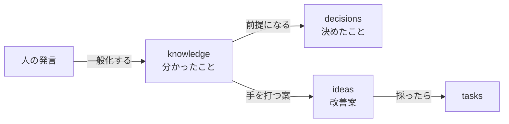

# 現場の知識

テストの自動化と、対象の業務アプリについての知識を積み上げる層です。書き方は [knowledge.md](../../.claude/rules/qata/knowledge.md)（D28）。特定の業務に固有のことは書かず、一般化して書きます。

| ファイル | 中身 | 増やすとき |
| --- | --- | --- |
| [glossary.md](glossary.md) | 用語集。qata で使い分けている言葉の定義 | 新しい言葉を使い始めたとき、言葉の意味を決め直したとき |
| [app-traits.md](app-traits.md) | 業務アプリの性質。対象のアプリが持ちうる、テストに効く性質 | 人から対象の前提を聞いたとき |
| [automation-pitfalls.md](automation-pitfalls.md) | 自動化で困ること。性質から起きる問題と、取りうる手 | 作っていて、困ったことが出たとき |
| [use-cases.md](use-cases.md) | 想定するユースケース。qata がどう使われるか | 人が決める（D29）。AI は案を出す |

## ほかの文書との違い

| 文書 | 何を置くか | いつまで |
| --- | --- | --- |
| ここ（knowledge） | 分かったこと（事実・前提・言葉の意味） | 積み上げる。古くなったら直す |
| [decisions.md](../decisions.md) | 決めたことと、その理由 | 記録として残す |
| [ideas.md](../ideas.md) | これからやるかもしれない改善案 | 使ったら消える |

- 決めたことや改善案の中に知識が出てきたら、知識はここに書き、decisions・ideas からはリンクで指す。
- 人がチャットで話した前提は、セッションの終わりに一般化してここに書く（[session-end](../../.claude/skills/session-end/SKILL.md)）。
