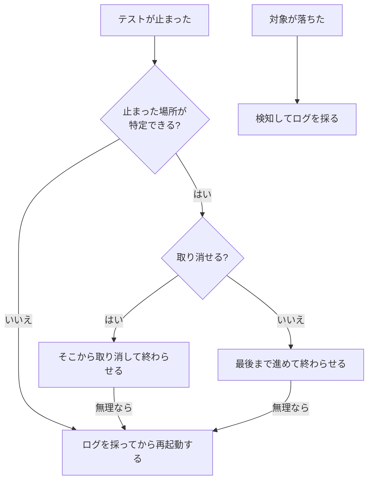

# 自動化で困ること

アプリの性質（[app-traits.md](app-traits.md)）や、自動化の一般論から起きる問題と、取りうる手です。手を打つ案は [ideas.md](../ideas.md) に置き、ここは知識だけにします。

| 困ること | なぜ起きる | 取りうる手 |
| --- | --- | --- |
| 前のテストの状態が残る | 起動し直せないアプリでは、前のテストが途中で止まると、その状態から次が始まる | 下の「立て直し」 |
| 読みたい文字が取れない | 古いアプリでは、UI Automation に文字が出ないことがある | 読み方を増やす（画像から読む、ウィンドウの文字を読む） |
| 「含む」で比べると、誤って通る | 「13」に「3」が含まれる | 完全一致で比べる。表示の飾り（「表示は … です」など）は、取り出してから比べる（D17） |
| 座標がずれる | ウィンドウの大きさ・画面の拡大率・つなぐ画面で、同じ部品の座標が変わる | 実行の前にウィンドウの大きさをそろえる。物理ピクセルで指す（D16） |
| スクショに要るものが写らない、要らないものが写る | 全画面で複数の画面にまたがるアプリと、ウィンドウのアプリが混ざる | アプリごとに範囲を選ぶ（D15） |
| 指定した大きさにできない | アプリに最小・最大の大きさがある | そろえたあとに測り、違えば操作を始めずに止める（qata-runner の R3） |
| 起動し直しても、前と同じ画面にならない | アプリが前の設定（表示のモードなど）を覚えていて、起動し直しても部品の並びが変わる | 始める前に決まった状態へ持っていく操作を入れる、または座標でなく部品を探して指す |
| ウィンドウの外枠で撮ると、後ろが写り込む | Windows の外枠には、見えない縁（数ピクセル）が含まれる | 見えている範囲（DWM）で撮る。タップの原点とは数ピクセルずれる（qata-runner の R3） |

## 起動し直せないアプリの立て直し

テストの前後で、止まった状態に応じて対象を操作し、次のテストを始められる状態に戻す。リグレッションテストを作るときに、最初に取り組むところ（人）。

