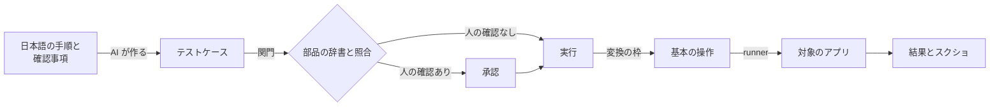

# 用語集

qata で使い分けている言葉の定義です。文書・コード・画面では、ここの言葉を使います。契約の名前（英語）は `コード` で添えます。

## 言葉のつながり

## テストケースまわり

| 言葉 | 意味 | 契約 |
| --- | --- | --- |
| テストケース | 一つのテスト。元の日本語と、実行する順に並べたステップを持つ | `testcase` |
| 元の日本語 | テストケースの元になった、日本語の手順と確認事項。人が見比べるために残す | `instruction` |
| ステップ | テストケースの一つの行。手順か確認事項のどちらか | `steps[]` |
| 手順 | 対象を操作するステップ。いまはキーを押す・タップするの二つ | `press_key`・`tap` |
| 確認事項 | 対象の状態を確かめるステップ。いまは、読んだ文字の完全一致の一つだけ（D17） | `expect_text` |
| アクション | テストケースに書けるステップの種類（手順と確認事項の総称） | `type` |
| 部品 | 画面の上の、操作したり読んだりするもの（ボタン・表示など）。名前で指す | `part` |
| 部品の辞書 | アプリごとの、部品の名前と、その部品に使えるアクションの一覧。名前を具体的な操作に変える仕組みでもある（D14） | `part-dictionary` |
| タグ | テストケースに付ける目印。機能・元の設計書・対象アプリの版で絞り込む（まだない、[ideas.md](../ideas.md)） | — |
| 有効な版 | テストケースが有効な、対象アプリの版の範囲。「この版から（必要ならこの版まで）」で持つ（まだない） | — |
| クローン | 元のテストケースの手順を流用し、確認事項だけ変えた新しいテストケース。元を記録し、タグを引き継ぐ（まだない） | — |

## 確かめる・実行するまわり

| 言葉 | 意味 | 契約 |
| --- | --- | --- |
| 関門 | 通らないと先に進めない検査。テストケースでは、形式の検証と部品の辞書との照合。開発では、テストと検査 | `schema`・`unknown_part` など |
| 人の確認 | 実行の前に、人がテストケースを見て承認すること。要るかどうかはチェックボックスで選ぶ | `needs_review` |
| 承認 | 人の確認を済ませること。確認の状態は、要らない・待ち・済の三つ | `not_required`・`pending`・`approved` |
| 実行 | テストケースを一回動かすこと | `run` |
| 変換の枠 | server の中で、部品の名前をキー・座標・読み方などに変える規則を差し込む所（D14） | — |
| 基本の操作 | runner が実行できる操作。いまはキー・タップ・文字を読むの三つ。runner は部品もテストケースも知らない（D16） | `key`・`tap`・`read_text` |
| 読み方 | 画面の文字を読む手段。いまは UI Automation だけ（D17） | `source.method`（`uia`） |
| スクショの範囲 | ウィンドウだけか、すべての画面をまとめて一枚か（D15） | `window`・`all_screens` |
| 結果 | 実行の結果。テストケース全体は 通った・落ちた・エラー、ステップはそれに「飛ばした」が加わる | `passed`・`failed`・`error`・`skipped` |
| 立て直し | テストが止まったあと、対象を次のテストを始められる状態に戻すこと。3 段で行う（[automation-pitfalls.md](automation-pitfalls.md)） | — |
| 始める前の状態 | テストケースごとに書く、始める前に対象がなっているべき状態。立て直しのあとで、戻ったかを確かめる（まだない） | — |
| 取り消しシナリオ | 立て直しの最初の段で流す、状況に合った汎用の操作の並び（まだない） | — |

## 作り方まわり

| 言葉 | 意味 |
| --- | --- |
| 契約 | 部品の間でやり取りするデータの形。正は親の [contracts/](../../contracts/) だけ |
| 親・子 | 親は判断と管理のリポジトリ（qata）。子は部品のリポジトリ（qata-server・qata-runner・qata-web） |
| 偽物 | 本物の代わりに、決まった答えを返すもの。端から端まで先につなぐために使う |
| 端から端までのテスト | AI の登録から、承認・実行・スクショまでを一本通すテスト（D26） |
| issue・idea | issue はいま困っている問題、idea は次回以降の改善案（D11） |
| 周回・セッション | 周回は、計画から振り返りまでのひとまとまり。セッションは、AI との一回の作業 |
| 外 | qata の範囲の外。判断（テストの中身を考える、次にすることを決める、不具合を報告する）は外の AI か人が行う（D39） |
| 切り出す道具 | qata の本体の外に、runner に頼らない独立したモジュールとして作る道具（設定・ログなど、D39） |

## この先増える種類

いまは最低限に絞っている。足すときは契約を変える（D14）。

| 種類 | いまあるもの | 増えそうなもの | 元になる知識 |
| --- | --- | --- | --- |
| 手順 | キーを押す・タップする | 修飾キーとの同時押し | [app-traits.md](app-traits.md) の「同時押しを判定する」 |
| 確認事項 | 読んだ文字の完全一致 | — | — |
| 読み方 | UI Automation | 画像から読む（OCR）、古いアプリのウィンドウの文字 | [app-traits.md](app-traits.md) の「古い Windows アプリ」 |
| スクショの範囲 | ウィンドウ・すべての画面 | — | [app-traits.md](app-traits.md) の「全画面で、複数の画面にまたがる」 |
| 実行の前後 | 毎回起動し直す | 状態から立て直す | [automation-pitfalls.md](automation-pitfalls.md) の「起動し直せない」 |
