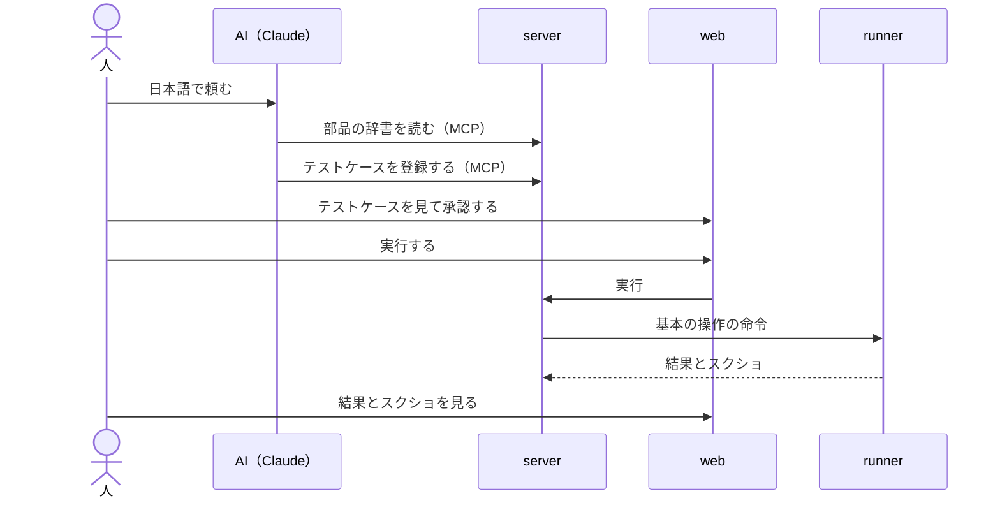

# 想定するユースケース

qata がどう使われるかです。ユースケースは人が決めます（D29）。AI は案を出し、人が確かめたら「状態」を「確定」にします。

| # | ユースケース | 誰が | 対象の性質 | 状態 |
| --- | --- | --- | --- | --- |
| U1 | 日本語で頼むと、電卓のテストが作られて動き、結果をスクショで見られる（デモ） | 技術を知らない人に見せる | ウィンドウのアプリ、起動し直せる | 確定（[scope.md](../scope.md)） |
| U2 | 業務アプリの改修のたびに、決まったテストを流し直す（リグレッションテスト） | テストの担当 | 起動し直さない場合にも対応する。ウィンドウを指定しない、全画面のケースにも対応する | 案 |
| U3 | 日本語の手順書から、テストケースをまとめて作る | テストの担当 | — | 案 |

## U1：デモ

- U2・U3 は AI の案です。[vision.md](../vision.md) の「できるようにしたいこと」と、[app-traits.md](app-traits.md) から出しました。
