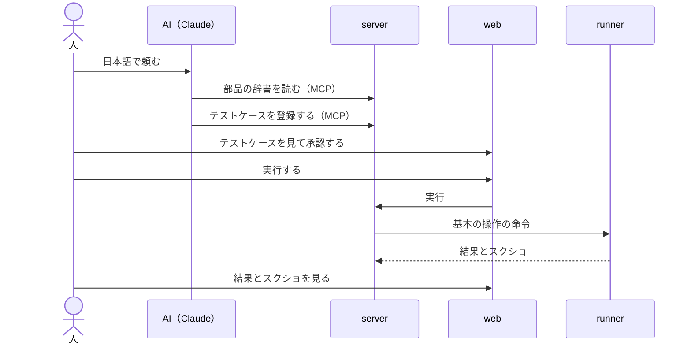

# 想定するユースケース

qata がどう使われるかです。ユースケースは人が決めます（D29）。AI は案を出し、人が確かめたら「状態」を「確定」にします。

| # | ユースケース | 誰が | 対象の性質 | 状態 |
| --- | --- | --- | --- | --- |
| U1 | 日本語で頼むと、電卓のテストが作られて動き、結果をスクショで見られる（デモ） | 技術を知らない人に見せる | ウィンドウのアプリ、起動し直せる | 確定（[scope.md](../scope.md)） |
| U2 | 業務アプリの改修のたびに、決まったテストを流し直す（リグレッションテスト） | テストの担当 | 起動し直さない場合にも対応する | 案 |
| U3 | 設計書や日本語の手順書から、テストケースをまとめて作る。AI が作るのを基本にし、人が作ったり直したりもできる | テストの担当 | — | 案 |
| U4 | 全画面表示のアプリに対しても、テストを作って動かし、結果をスクショで見られる | テストの担当 | ウィンドウを指定しない、全画面のケースにも対応する | 案 |
| U5 | AI がテストを作り、流し、止まったら立て直し、結果と証拠を不具合の報告に渡すまで、自律して回す | テストの担当 | 起動し直さない場合にも対応する | 案 |

## U4：全画面表示のアプリ

ウィンドウのアプリ（U1）と比べて、変わるところです。

| 項目 | ウィンドウのアプリ（U1） | 全画面表示のアプリ（U4） | いまの契約 |
| --- | --- | --- | --- |
| ウィンドウの大きさ | 実行の前にそろえる | そろえない（大きさを書かない） | 対応済み（D16） |
| スクショの範囲 | ウィンドウだけ | すべての画面をまとめて一枚 | 対応済み（D15） |
| 座標の原点 | ウィンドウの外枠の左上 | 画面の左上（全画面ではウィンドウと画面が重なる） | 要確認：複数の画面のときの原点 |

## U1：デモ

- U5 と、U3 を「設計書など」「人も作る」に広げたものは、機能のブレスト（[qata#34](https://github.com/masakazu2025/qata/issues/34)）から出しました。qata の範囲と、外で行うことの分け方は D39。
- U2・U3 は AI の案です。[vision.md](../vision.md) の「できるようにしたいこと」と、[app-traits.md](app-traits.md) から出しました。
