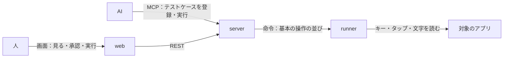

# コードとテストのレビュー（2026-11）

server・runner・web のコードとテストを、書いた AI とは別の AI にレビューさせた結果です（[qata#23](https://github.com/masakazu2025/qata/issues/23)）。ここから、レビューの観点を決めます（[qata#47](https://github.com/masakazu2025/qata/issues/47)）。

- 人が読むのは [要約](#要約) だけでよい。ソースを読んでいなくても分かるように書く。
- その下の [やり方](#やり方)・[全体の傾向](#全体の傾向)・部品ごとの詳細（[server](#qata-server)・[runner](#qata-runner)・[web](#qata-web)）は、直すときと観点を決めるときに AI が使う。

## 要約

### 前提：部品のつながり

| 部品 | すること |
| --- | --- |
| server | テストケースを持ち、関門で検査する。実行するときは、テストケースを基本の操作（キー・タップ・文字を読む）の並びに直して runner に送り、返ってきた結果を「合格・不合格・エラー」にまとめて残す |
| runner | 対象のアプリを起動し、言われた操作をそのまま行い、ステップごとの結果とスクショを返す。テストケースの中身は知らない |
| web | 人がテストケースと実行の結果を見て、承認・実行・削除をする画面 |

- テストケースの前に、server は「前準備」（アプリを決まった状態にする操作）を runner に送る。
- 人の確認が要るテストケースは、承認してからでないと実行できない。

### 重いもの

#### 1 実行が重なると一つのアプリに操作が混ざる

runner は 1 台の PC の画面で、本物のアプリを動かします。同時に動かせるのは一つだけのはずです。ところが、server にも runner にも、実行を一つずつ順に流す仕組みがありません。画面で実行しているあいだに AI が MCP から実行するなど、二つの実行が重なると、どちらも同時に始まります。あとから始まった実行が、先の実行のアプリを閉じてしまったり、キーの入力が混ざったりします。

- 困ること：どちらのテストの結果も信用できなくなる。業務アプリなら、意図しない操作が入るおそれもある。
- 詳細：[S1](#s1)・[R1](#r1)。部品をまたぐので、どこで一つずつにするかは親で決める（`docs/ideas.md`）。

#### 2 実行中に画面を行き来すると同じテストが二回動く

画面で「実行する」を押すと、アプリが実際に動き、終わるまで数十秒かかります。そのあいだ、ボタンは押せない状態になります。ところが、左の一覧で別のテストケースを開いて戻ると、ボタンがまた押せる状態に戻っています。押すと、一つめが終わる前に二つめが始まり、1 と同じことが起きます。一つめの結果も、戻った画面には出ません。

- 困ること：人が普通に画面を使うだけで起きる。
- 詳細：[W1](#w1)。

#### 3 前準備が失敗しても合格になることがある

runner は、ステップでエラーが起きたらそこで止める決まりです。server は、その決まりが守られていない結果を、壊れた結果としてはじくはずです。ところが、「最後まで動いた」と言いながら途中にエラーがある結果は、はじいていません。前準備でエラーが出ていても、テストケースのステップが全部うまくいっていれば、実行は「合格」になります。

- 困ること：失敗が隠れる。テストのツールとしていちばん困る形。いまの runner はこういう結果を返さないが、runner を直したときや、別の runner を作ったときに気づけない。
- 詳細：[S3](#s3)。

#### 4 想定していないエラーでそれまでの結果が消える

部品のあいだでやり取りする形は、契約で決めています。エラーのときも、決めた形（理由のコードと文）で返すことになっています。ところが、想定していない例外が起きると、どちらの部品も決めた形ではなく、「Internal Server Error」の一文だけを返します。runner では、それまでに済んだステップの結果とスクショも失われます。起きる場面は、たとえば次のとおりです。

- 同じタイトルのウィンドウが二つある、同じ部品が画面に二つある（一覧の行など）。業務アプリではよくあるが、電卓ではない。
- runner の返したスクショのデータが壊れている。

困ること：何が起きたのか、画面にもログにも手がかりが残らない。

- 詳細：[R2](#r2)・[S2](#s2)・[S7](#s7)。

#### 5 承認したのに確認待ちに戻り消したものが一覧に戻る

画面の一覧は、3 秒ごとに読み直しています。読み直しの応答が届く前に「承認する」を押すと、承認の前に読んだ古い一覧があとから届き、承認済みの表示を確認待ちに戻してしまいます。server の中でも、承認と削除がほぼ同時に起きると、消したテストケースが生き返ることがあります。

- 困ること：次の読み直しで直ることが多いが、人が「承認できていない」「消えていない」と迷う。
- 詳細：[W3](#w3)・[S6](#s6)。

### テストの抜け

1〜5 に共通して、テストが「うまくいく道」に寄っています。同時に動いたとき・エラーのとき・相手の応答が遅いときを確かめるテストがほとんどありません。テストで使う偽の server と runner はすぐに応答し、練習台の電卓は素直なアプリなので、こうした不具合がテストに出てきません。詳しくは [全体の傾向](#全体の傾向)。

## やり方

| 項目 | 中身 |
| --- | --- |
| レビューした AI | 部品ごとに一つ、経緯を渡さない新しい会話の AI（3 つを並べて動かした） |
| 渡したもの | リポジトリの場所、契約（`contracts/`）、`docs/architecture.md`。読むだけで、ファイルは変えない |
| 探したもの | 型や書き方の誤り（pyright・ESLint・tsc が拾うもの）を除いた、動きの不具合・テストの抜け・契約との食い違い・設計のずれ |
| 確かめ方 | レビューした AI は、使い捨ての試し（偽の runner・偽の server・遅らせた応答）で動かせるものは動かした。重さが高のものは、書いた側の AI も手元で読み直して確かめた |
| 対象の版 | qata-server `1f591c4`、qata-runner `90e5b07`、qata-web `0360adf`、qata `d8fcbf0` |

- 「確かめ方」の「確かめた」は、動かして起きることを見たもの。「読んだだけ」は、コードを読んで起きると分かったもの。
- 「設計のずれ」のうち、D43（土台を固める）でまだ入れていないだけのもの（SQLAlchemy・pydantic-settings・MCP を HTTP に・React Router など）は、それぞれ issue があるので一覧から外した。外したものは、末尾の「外したもの」に置く。

## 全体の傾向

[↑ 要約に戻る](#要約)

| 傾向 | 出た部品 | 防ぐもの（観点の候補） |
| --- | --- | --- |
| 同時に動いたときのテストがない。実行を一つずつにする仕組みが、server にも runner にもない | server・runner・web | 遅らせた偽の相手に、同時に 2 本投げるテスト |
| 異常系の分かれ道ごとのテストがない。正常系と、契約の 422 に寄っている | server・runner・web | 分かれ道（エラーのコード・status）ごとに、表にしたテスト |
| 捕まえない例外のとき、契約の形ではなく `text/plain` の 500 が返る | server・runner | 何でも捕まえて契約の形で返す仕組みと、そのテスト |
| 偽の相手（runner・server・電卓）でたまたま成り立つことに頼っている。偽はすぐ応答し、電卓はタイトルが一つで、すぐ閉じる | runner・web | 偽に遅れ・失敗・業務アプリの性質（同じ ID の要素がいくつも、閉じるときに確認が出る）を入れられるようにする |
| 契約との突き合わせが、形（コード・型の名前）だけで、制約（pattern）や例どうしの対応を見ていない | server・runner | 引数の schema まで突き合わせる検査。命令と結果の例が対応しているかのテスト |

## qata-server

[↑ 要約に戻る](#要約)

#### S1

- 重さ：高　種類：不具合
- 場所：`service.py:188-231`、`rest.py:179`、`mcp_server.py:378`
- 何が起きるか：実行を一つずつにする仕組みがない。REST の実行は同期の関数でスレッドに並び、MCP は別のプロセスなので、1 台の runner に命令が同時に届く。D43 の「実行は一つずつで、プロセスの中で足りる」と合わない
- 確かめ方：確かめた（0.5 秒待つ偽の runner に REST で 3 本同時に投げ、3 本とも 201、runner が同時に受けた数は 3）
- 防げたもの：遅い偽の runner に 2 本同時に投げ、呼び出しが重ならない（または 2 本目が 409 になる）ことを見る application・REST のテスト
- [↑ 要約に戻る](#1-実行が重なると一つのアプリに操作が混ざる)

#### S2

- 重さ：中　種類：不具合
- 場所：`service.py:248-253`
- 何が起きるか：スクショの `data_base64` に ASCII でない文字があると、`b64decode` が `binascii.Error` ではない `ValueError` を投げる。結果が残らず、REST は 500、MCP は JSON-RPC のエラーになる。「使えない結果は `invalid_runner_result` として残す」に反する
- 確かめ方：確かめた（レビューした AI が Service・REST・MCP で。書いた側も `b64decode("あ", validate=True)` が `ValueError` を投げることを確かめた）
- 防げたもの：`_why_broken` の判定ごとに壊れた結果を返す、表にしたシナリオ（Base64 でない・ASCII でない・run_id が違う・index が飛ぶ・数が足りない）
- [↑ 要約に戻る](#4-想定していないエラーでそれまでの結果が消える)

#### S3

- 重さ：中　種類：不具合
- 場所：`service.py:243-247`、`266-272`、`293-302`
- 何が起きるか：`status: completed` なのに途中のステップが `error` の結果を、はじかない。前準備のステップが error だと実行が `passed` になり、失敗が隠れる。途中が error だと、そのあとが `passed` になる
- 確かめ方：確かめた（前準備が error のとき `passed`。途中が error のとき `passed, error, passed, passed, passed`）
- 防げたもの：「completed なのに error がある」「error のあとにもステップがある」結果が `invalid_runner_result` になるテスト
- [↑ 要約に戻る](#3-前準備が失敗しても合格になることがある)

#### S4

- 重さ：中　種類：テストの抜け
- 場所：`service.py:196-202`
- 何が起きるか：登録のあとで部品の辞書が変わったら断る分かれ道（`testcase_out_of_date`）に、application・REST・MCP のどれにもテストがない
- 確かめ方：確かめた（tests を grep して 0 件。動きは、辞書から部品を外して断られることを確かめた）
- 防げたもの：辞書の部品を減らして、実行が `testcase_out_of_date` で断られる application のテストと、REST の 409 のテスト

#### S5

- 重さ：中　種類：テストの抜け
- 場所：`tests/support.py:42-43`、`tests/application/runs.feature`
- 何が起きるか：壊れた結果のテストは、schema で落ちる 1 つだけ。`_why_broken` が独自に確かめる 4 つは動かしていない。S2 はここから漏れた
- 確かめ方：読んだだけ
- 防げたもの：S2 と同じ、表にしたシナリオ

#### S6

- 重さ：低　種類：不具合
- 場所：`service.py:125-136`、`store.py:430-440`
- 何が起きるか：承認は「読んで、書く」で、書くのは upsert。そのあいだに消されると、消したテストケースが生き返る
- 確かめ方：確かめた（読むのと書くのとのあいだに消すと、一覧に残った）
- 防げたもの：消したあとの承認が 404 になり、生き返らないことを見るテスト
- [↑ 要約に戻る](#5-承認したのに確認待ちに戻り消したものが一覧に戻る)

#### S7

- 重さ：低　種類：契約との食い違い
- 場所：`rest.py:56-70`、`226-231`、`mcp_server.py:376-380`
- 何が起きるか：決めたエラー以外の例外は、REST だと `text/plain` の 500 で、契約の error_response の形にならない（S2 や、深く入れ子にした JSON の本文）。MCP も JSON-RPC のエラーになる
- 確かめ方：確かめた（`[` を 10 万個並べた本文で 500）
- 防げたもの：何でも捕まえて `internal_error` の error_response で返す仕組みと、そのテスト
- [↑ 要約に戻る](#4-想定していないエラーでそれまでの結果が消える)

#### S8

- 重さ：低　種類：契約との食い違い
- 場所：`rest.py:107`、`store.py:453`、`tests/rest/test_rest.py:97-99`
- 何が起きるか：openapi では `app_id` に pattern があるが、server は何でも受け、`?app_id=` は全件ではなく 0 件を返す。openapi との突き合わせのテストは、引数の名前・場所・必須しか見ていない
- 確かめ方：確かめた（`?app_id=` で 0 件、付けないと 1 件）
- 防げたもの：引数の schema（pattern など）まで openapi と突き合わせる検査

#### S9

- 重さ：低　種類：テストの抜け
- 場所：`tests/rest/rest.feature`
- 何が起きるか：openapi の「結果が failed・error でも 201」を、REST では確かめていない（passed の 1 通りだけ）
- 確かめ方：読んだだけ
- 防げたもの：runner に違う表示を返させて、REST が 201・`failed` になるシナリオ

## qata-runner

[↑ 要約に戻る](#要約)

#### R1

- 重さ：高　種類：不具合
- 場所：`rest.py:36`、`windows.py:86-`
- 何が起きるか：`POST /runs` を順に流す仕組みがなく、命令は別々のスレッドで同時に動く。あとの実行が先の実行のウィンドウを閉じ、キーとタップが混ざる。server が 300 秒で打ち切っても runner は止まらず、次の命令と重なる
- 確かめ方：確かめた（0.5 秒眠る偽の操作に 3 件同時に送り、同時に動いた数は 3。書いた側も、`run_in_threadpool` の前後に順に流す仕組みがないことを読んで確かめた）
- 防げたもの：遅い偽の操作に 2 件同時に送り、重ならない（または 2 件目が断られる）ことを見る REST のテスト
- [↑ 要約に戻る](#1-実行が重なると一つのアプリに操作が混ざる)

#### R2

- 重さ：高　種類：不具合
- 場所：`windows.py:137`・`147-161`・`196-198`、`rest.py:36`
- 何が起きるか：決めた失敗（`StepFailed`）以外の例外を捕まえず、契約の結果ではなく `text/plain` の 500 が返る。それまでのステップの結果とスクショも失われる。起きる場面：同じタイトルのウィンドウが二つ、同じ AutomationId の要素が二つ、ウィンドウが出てすぐ消える
- 確かめ方：500 は確かめた（例外を投げる操作で）。場面の三つは pywinauto のコードを読んだだけ
- 防げたもの：操作が予期しない例外を投げたとき、契約に合う aborted が返る REST のテスト。pywinauto を差し替えて、要素が二つあるときの例外を投げさせる単体テスト
- [↑ 要約に戻る](#4-想定していないエラーでそれまでの結果が消える)

#### R3

- 重さ：中　種類：不具合
- 場所：`windows.py:225-236`
- 何が起きるか：前の実行のウィンドウが 5 秒で閉じない（閉じるときに確認が出たなど）と、何も言わずに先へ進む。前の状態のまま進むか、同じタイトルが二つになって R2 になる
- 確かめ方：読んだだけ
- 防げたもの：閉じないウィンドウを差し替えで作り、aborted で止まることを見る単体テスト

#### R4

- 重さ：中　種類：契約との食い違い
- 場所：`windows.py:197`
- 何が起きるか：契約の `text_source_uia` は「要素の Name を読む」。pywinauto の `window_text()` は、TextPattern を持つ要素では Name ではなく本文を返す。入力欄などで契約と違う文字が返る。電卓では同じなので、テストでは見えない
- 確かめ方：読んだだけ（pywinauto のコード）
- 防げたもの：Name と本文が違う要素を差し替えで作り、読む値を見る単体テスト

#### R5

- 重さ：中　種類：テストの抜け
- 場所：`tests/windows/test_windows.py`、`windows.py:101-122`
- 何が起きるか：本物の操作の流れ（止め方・ステップの作り方・aborted の形）は、デスクトップのテストでしか確かめておらず、CI では全部飛ぶ。`launch_failed`・`key_failed`・`tap_failed`・`screenshot_failed` はどこにもテストがない
- 確かめ方：確かめた（tests を grep して 0 件。デスクトップなしで 6 件飛ぶ）
- 防げたもの：pywinauto・スクショ・プロセスの起動を差し替えた単体テスト。四つのコードごとに、結果が契約に通り、ステップの数が合うことを見る

#### R6

- 重さ：低　種類：不具合
- 場所：`windows.py:188-191`
- 何が起きるか：タップの座標がウィンドウの大きさの外でも、そのままクリックする。対象の外（後ろのアプリ、人が使っている画面）を押す
- 確かめ方：読んだだけ
- 防げたもの：大きさの外の座標が `tap_failed` になる単体テスト

#### R7

- 重さ：低　種類：不具合
- 場所：`fake.py:86`
- 何が起きるか：契約に `window.size` の上限がなく、偽の操作に 100000 x 100000 を送ると `MemoryError` で 500 になる
- 確かめ方：確かめた
- 防げたもの：大きな size の境目の値を送る REST のテスト（上限を契約か runner で決める）

#### R8

- 重さ：低　種類：契約との食い違い
- 場所：親 `contracts/schemas/runner-result.schema.json` の `screenshot.description`
- 何が起きるか：説明は「対象のウィンドウだけのスクショ」。命令の `scope: all_screens`（すべての画面）と食い違う
- 確かめ方：読んだだけ
- 防げたもの：契約に項目を足したとき、関わる説明も見直すレビューの観点

#### R9

- 重さ：低　種類：契約との食い違い
- 場所：親 `contracts/examples/runner-command.json`・`runner-result.json`
- 何が起きるか：二つの例が対応していない。命令は 7 ステップで、結果は 5 ステップ。文字を読むステップの番号も合わない。run_id は同じなので、対応しているように見える
- 確かめ方：確かめた（書いた側も、7 と 5 を数えて確かめた）
- 防げたもの：命令と結果の例のステップの数と番号が合うことを見るテスト

#### R10

- 重さ：低　種類：設計のずれ
- 場所：`fake.py:64-68`、`windows.py:204-215`
- 何が起きるか：偽の操作のスクショは `window.size` ちょうど。本物は見えない縁のぶん小さい。偽でつないだ server・web は本物の大きさを前提にできないが、違うことがどこにも書いていない
- 確かめ方：読んだだけ
- 防げたもの：偽と本物で、スクショの大きさの決まりを同じ文で書き、両方のテストで同じことを見る

#### R11

- 重さ：低　種類：設計のずれ
- 場所：`main.py`、`src` 全体
- 何が起きるか：architecture.md の土台は「設定は pydantic-settings で一か所に」。runner は環境変数を直接読み、待ち時間も変えられない。server には同じ issue があるが、runner にはない（ログは qata-runner#10 がある）
- 確かめ方：確かめた（grep して 0 件）
- 防げたもの：architecture.md の土台と、部品の依存を突き合わせるレビューの観点

## qata-web

[↑ 要約に戻る](#要約)

#### W1

- 重さ：高　種類：不具合
- 場所：`TestcaseDetail.tsx:17,37-39`、`App.tsx:99`
- 何が起きるか：実行は終わるまで応答が返らない。その間に別のテストケースを選んで戻ると、詳細が作り直されて「実行中」が消え、「実行する」がまた押せる。二度目の実行が出て、本物のアプリが二重に動く。一つめの結果は画面に出ない
- 確かめ方：確かめた（実行の応答を遅らせ、移って戻って押すと、実行が 2 回送られた。書いた側も、実行中の状態を詳細の中だけで持ち、`key` で作り直されることを読んで確かめた）
- 防げたもの：「実行中に別のものへ移って戻っても、実行するが押せず、終わると結果が出る」画面のテスト
- [↑ 要約に戻る](#2-実行中に画面を行き来すると同じテストが二回動く)

#### W2

- 重さ：中　種類：不具合
- 場所：`TestcaseDetail.tsx:29,39,144`
- 何が起きるか：実行の結果の一覧を読むのに失敗したあと「承認する」を押すと、エラーが消え、「読み込み中…」が出たまま止まる。一覧のエラーと操作のエラーを一つの状態で持っているため
- 確かめ方：確かめた（GET /runs を 500 にして承認した）
- 防げたもの：「結果の一覧の読み込みに失敗したあとに操作したとき」の画面のテスト

#### W3

- 重さ：中　種類：不具合
- 場所：`App.tsx:18-28,41-42`
- 何が起きるか：一覧の読み直しの途中で承認すると、承認の前に読んだ一覧があとから着いて、承認済みを確認待ちで上書きする。消したものが一覧に戻るのも同じ。古い応答を捨てる仕組みがない
- 確かめ方：確かめた（読み直しの応答を止めたまま承認し、そのあと流した）
- 防げたもの：応答の順を入れ替える偽の fetch で、「読み込み中の一覧より後に承認したら、承認が残る」テスト
- [↑ 要約に戻る](#5-承認したのに確認待ちに戻り消したものが一覧に戻る)

#### W4

- 重さ：中　種類：不具合・テストの抜け
- 場所：`api.ts:13-17`、`tests/app.test.tsx:47-51`
- 何が起きるか：「server に届きません」の案内が出るのは fetch が投げたときだけ。実際は、server が落ちていると vite の中継が本文なしの 502 を返すので、案内が出ない。テストは fetch が投げる形しか作っていない
- 確かめ方：確かめた（vite のソースを読み、空の 502 を返す fetch で動かした）
- 防げたもの：「中継が空の 502 を返したとき、届かないと分かる」画面のテスト

#### W5

- 重さ：中　種類：テストの抜け
- 場所：`tests/app.test.tsx` 全体、`RunView.tsx:14-18,31,37`
- 何が起きるか：実行の `status: error` と理由の表示、`skipped` のステップ、スクショなし、実行の 409（`review_pending`・`testcase_out_of_date`）、結果の一覧の失敗、確かめでキャンセル、空の一覧、読み込み中のテストが一つもない
- 確かめ方：確かめた（grep で 0 件）
- 防げたもの：契約の `error`・`skipped` を使った結果の画面のテスト、409 の画面のテスト、キャンセルのテスト

#### W6

- 重さ：中　種類：テストの抜け
- 場所：`tests/app.test.tsx:76-78`、`tests/demo.test.tsx:248-249`
- 何が起きるか：承認のあと「実行する」を待つつもりの書き方だが、ボタンは押せない形で前からあるので、すぐ見つかって待たない。偽の server がすぐ応答するので通っているだけ
- 確かめ方：確かめた（承認を 50ms 遅らせると、見つかったボタンは押せないまま）
- 防げたもの：押せるようになるまで待つ書き方（`toBeEnabled` を待つ）。偽の server に遅れを入れて回すテスト

#### W7

- 重さ：低　種類：不具合
- 場所：`api.ts:23-31`、`TestcaseDetail.tsx:47-50`
- 何が起きるか：ほかから（MCP など）先に消されていて DELETE が 404 になると、「見つかりません」と出て詳細が残る。届かないときの文言も、ほかの API とずれている
- 確かめ方：確かめた
- 防げたもの：「DELETE が 404 を返したとき」の画面のテスト

#### W8

- 重さ：低　種類：設計のずれ
- 場所：`TestcaseDetail.tsx:20-33`
- 何が起きるか：実行の結果の一覧は、開いたときに一度だけ読む。MCP で実行しても、開いたままの詳細には出ない。README の「開いたままの画面に出る」は登録にしか効いていない
- 確かめ方：読んだだけ
- 防げたもの：「ほかから実行が足されたら、開いた詳細に出る」テスト

#### W9

- 重さ：低　種類：テストの抜け
- 場所：`tests/app.test.tsx:92`、`vite.config.ts`
- 何が起きるか：`window.confirm` の差し替えを元に戻していない。そのあとのテストでは確かめが常に「はい」になり、キャンセルの分かれ道を書いても気づかずに通る
- 確かめ方：読んだだけ
- 防げたもの：設定の `restoreMocks: true`

## 外したもの

[↑ 要約に戻る](#要約)

D43 で入れると決めて、まだ入れていないだけのもの。それぞれ issue がある。

| 指摘 | issue |
| --- | --- |
| server が生の sqlite3 を使っている | qata-server#13 |
| server が環境変数を直接読んでいる | qata-server#12 |
| MCP が stdio で、REST と別のプロセス | qata-server#14（S1 の、プロセスをまたぐ同時実行もここで変わる） |
| web に React Router・TanStack Query・Tailwind・shadcn/ui が入っていない。architecture.md の書き方では、もう入っているように読める | qata-web#12・#13（W3 の古い応答の上書きは、TanStack Query で変わる） |
| runner・server・web がログを出していない | qata-runner#10・qata-server#15・qata-web#14 |
