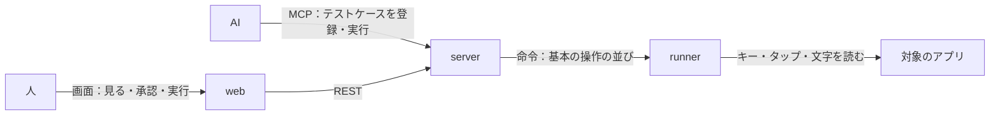

# コードとテストのレビュー（2026-11）

server・runner・web のコードとテストを、書いた AI とは別の AI にレビューさせた結果です（[qata#23](https://github.com/masakazu2025/qata/issues/23)）。ここから、レビューの観点を決めます（[qata#47](https://github.com/masakazu2025/qata/issues/47)）。

- [前提](#前提)：部品のつながり
- [一覧](#一覧)：見つかったこと（重い順）。番号から説明に飛べる。「扱い」は、直す issue か、`docs/ideas.md` に置いたか（振り分けの基準は `.claude/rules/qata/findings.md`）
- [全体の傾向](#全体の傾向)・[やり方](#やり方)・[外したもの](#外したもの)

## 前提

| 部品 | すること |
| --- | --- |
| server | テストケースを持ち、関門で検査する。実行するときは、テストケースを基本の操作（キー・タップ・文字を読む）の並びに直して runner に送り、返ってきた結果を「合格・不合格・エラー」にまとめて残す |
| runner | 対象のアプリを起動し、言われた操作をそのまま行い、ステップごとの結果とスクショを返す。テストケースの中身は知らない |
| web | 人がテストケースと実行の結果を見て、承認・実行・削除をする画面 |
| 契約 | 部品のあいだでやり取りするデータの形。親のリポジトリに置く |

- テストケースの前に、server は「前準備」（アプリを決まった状態にする操作）を runner に送る。
- 人の確認が要るテストケースは、承認してからでないと実行できない。
- テストでは、相手の部品の代わりに偽の server・偽の runner・偽の操作を使う。本物の操作は、練習台の電卓で確かめている。

## 一覧

| # | 重さ | 部品 | 何が起きるか | 扱い |
| --- | --- | --- | --- | --- |
| [1](#1-実行が重なると一つのアプリに操作が混ざる) | 高 | server・runner | 実行が重なると一つのアプリに操作が混ざる | [qata#51](https://github.com/masakazu2025/qata/issues/51) |
| [2](#2-実行中に画面を行き来すると同じテストが二回動く) | 高 | web | 実行中に画面を行き来すると同じテストが二回動く | [qata-web#16](https://github.com/masakazu2025/qata-web/issues/16) |
| [3](#3-想定していないエラーでそれまでの結果が消える) | 高 | server・runner | 想定していないエラーでそれまでの結果が消える | [qata-runner#12](https://github.com/masakazu2025/qata-runner/issues/12)・[qata-server#17](https://github.com/masakazu2025/qata-server/issues/17) |
| [4](#4-前準備が失敗しても合格になることがある) | 中 | server | 前準備が失敗しても合格になることがある | [qata-server#18](https://github.com/masakazu2025/qata-server/issues/18) |
| [5](#5-承認したのに確認待ちに戻り消したものが一覧に戻る) | 中 | web・server | 承認したのに確認待ちに戻り消したものが一覧に戻る | [qata-web#18](https://github.com/masakazu2025/qata-web/issues/18)（server 側は ideas） |
| [6](#6-前のアプリが閉じないまま次の実行が始まる) | 中 | runner | 前のアプリが閉じないまま次の実行が始まる | [qata-runner#14](https://github.com/masakazu2025/qata-runner/issues/14) |
| [7](#7-読んだ文字が決めたものと違うことがある) | 中 | runner | 読んだ文字が決めたものと違うことがある | [qata-runner#14](https://github.com/masakazu2025/qata-runner/issues/14) |
| [8](#8-結果の一覧の読み込みに失敗したあと読み込み中のまま止まる) | 中 | web | 結果の一覧の読み込みに失敗したあと読み込み中のまま止まる | [qata-web#17](https://github.com/masakazu2025/qata-web/issues/17) |
| [9](#9-server-が止まっていても届かないという案内が出ない) | 中 | web | server が止まっていても届かないという案内が出ない | [qata-web#17](https://github.com/masakazu2025/qata-web/issues/17) |
| [10](#10-壊れた結果を見分ける検査の大半にテストがない) | 中 | server | 壊れた結果を見分ける検査の大半にテストがない | [qata-server#18](https://github.com/masakazu2025/qata-server/issues/18) |
| [11](#11-テストケースが古くなったときに断る動きにテストがない) | 中 | server | テストケースが古くなったときに断る動きにテストがない | [qata-server#18](https://github.com/masakazu2025/qata-server/issues/18) |
| [12](#12-本物の操作の流れが自動のテストで一度も確かめられていない) | 中 | runner | 本物の操作の流れが自動のテストで一度も確かめられていない | [qata-runner#13](https://github.com/masakazu2025/qata-runner/issues/13) |
| [13](#13-エラーや飛ばしたステップの表示にテストがない) | 中 | web | エラーや飛ばしたステップの表示にテストがない | [qata-web#17](https://github.com/masakazu2025/qata-web/issues/17) |
| [14](#14-待つつもりのテストが待たずに進んでいる) | 中 | web | 待つつもりのテストが待たずに進んでいる | [qata-web#18](https://github.com/masakazu2025/qata-web/issues/18) |
| [15](#15-アプリの外を押してしまうことがある) | 低 | runner | アプリの外を押してしまうことがある | ideas |
| [16](#16-大きすぎる画面の大きさを送ると止まる) | 低 | runner | 大きすぎる画面の大きさを送ると止まる | ideas |
| [17](#17-アプリを空で絞り込むと全件ではなく0件になる) | 低 | server | アプリを空で絞り込むと全件ではなく0件になる | ideas |
| [18](#18-不合格のときの返し方をrestで確かめていない) | 低 | server | 不合格のときの返し方をRESTで確かめていない | ideas |
| [19](#19-先に消されていたものを消すと失敗に見える) | 低 | web | 先に消されていたものを消すと失敗に見える | ideas |
| [20](#20-mcpで実行しても開いたままの画面に結果が出ない) | 低 | web | MCPで実行しても開いたままの画面に結果が出ない | [qata-web#18](https://github.com/masakazu2025/qata-web/issues/18) |
| [21](#21-テストの差し替えが元に戻らず次のテストに残る) | 低 | web | テストの差し替えが元に戻らず次のテストに残る | ideas |
| [22](#22-契約の例と説明が実際と食い違う) | 低 | 契約 | 契約の例と説明が実際と食い違う | ideas |
| [23](#23-テスト用と本物でスクショの大きさが違う) | 低 | runner | テスト用と本物でスクショの大きさが違う | ideas |
| [24](#24-runnerの設定が一か所にまとまっていない) | 低 | runner | runnerの設定が一か所にまとまっていない | ideas |

## 説明

### 1 実行が重なると一つのアプリに操作が混ざる

runner は 1 台の PC の画面で本物のアプリを動かすので、同時に動かせる実行は一つだけです。ところが、server にも runner にも、実行を一つずつ順に流す仕組みがありません。画面で実行しているあいだに AI が MCP から実行するなど、二つの実行が重なると、どちらも同時に始まります。あとから始まった実行が先の実行のアプリを閉じたり、キーの入力が混ざったりします。server は 300 秒で待つのをやめますが、runner の側はそのあとも動き続けるので、次の実行とも重なります。

困ること：どちらのテストの結果も信用できなくなる。業務アプリなら、意図しない操作が入るおそれもある。

部品をまたぐので、どこで一つずつにするかは親で決める（`docs/ideas.md`）。

- 重さ：高　部品：server・runner
- 場所：server `service.py:188-231`、`rest.py:179`、`mcp_server.py:378`。runner `rest.py:36`、`windows.py:86-`
- 確かめ方：確かめた。server：0.5 秒待つ偽の runner に REST で 3 本同時に投げ、3 本とも 201、runner が同時に受けた数は 3。runner：0.5 秒眠る偽の操作に 3 件同時に送り、同時に動いた数は 3
- 防げたもの：遅い偽の相手に 2 本同時に投げ、重ならない（または 2 本目が 409 で断られる）ことを見るテスト（server の application と REST、runner の REST）
- [↑ 一覧に戻る](#一覧)

### 2 実行中に画面を行き来すると同じテストが二回動く

画面で「実行する」を押すと、アプリが実際に動き、終わるまで数十秒かかります。そのあいだ、ボタンは押せない状態になります。ところが、左の一覧で別のテストケースを開いて戻ると、ボタンがまた押せる状態に戻っています。押すと、一つめが終わる前に二つめが始まり、1 と同じことが起きます。一つめの結果も、戻った画面には出ません。

困ること：人が普通に画面を使うだけで起きる。

- 重さ：高　部品：web
- 場所：`TestcaseDetail.tsx:17,37-39`、`App.tsx:99`
- 確かめ方：確かめた。実行の応答を遅らせ、移って戻って押すと、実行が 2 回送られた。書いた側も、実行中かどうかを詳細の画面の中だけで持っていて、選び直すと作り直されることを読んで確かめた
- 防げたもの：「実行中に別のものへ移って戻っても、実行するが押せず、終わると結果が出る」画面のテスト
- [↑ 一覧に戻る](#一覧)

### 3 想定していないエラーでそれまでの結果が消える

部品のあいだでやり取りする形は契約で決めていて、エラーのときも、決めた形（理由のコードと文）で返すことになっています。ところが、想定していない例外が起きると、どちらの部品も決めた形ではなく、「Internal Server Error」の一文だけを返します。runner では、それまでに済んだステップの結果とスクショも失われます。起きる場面は、たとえば次のとおりです。

- 同じタイトルのウィンドウが二つある、同じ部品が画面に二つある（一覧の行など）。業務アプリではよくあるが、電卓ではない。
- 開いたウィンドウがすぐ消える（起動のときだけ出る画面など）。
- runner の返したスクショのデータに、読めない文字が入っている。
- server に、極端に深く入れ子にしたデータが送られる。

困ること：何が起きたのか、画面にもログにも手がかりが残らない。

- 重さ：高　部品：server・runner
- 場所：runner `windows.py:137`・`147-161`・`196-198`、`rest.py:36`。server `service.py:248-253`（スクショのデータ）、`rest.py:56-70`・`226-231`、`mcp_server.py:376-380`
- 確かめ方：確かめた。runner：例外を投げる操作で 500 になった（どの場面で例外が出るかは、pywinauto のコードを読んだだけ）。server：スクショのデータを「あ」にすると Service・REST・MCP のどれでも結果が残らなかった（`b64decode` が `binascii.Error` ではない `ValueError` を投げる）。`[` を 10 万個並べた本文で 500
- 防げたもの：何でも捕まえて契約の形（runner は aborted、server は `internal_error` の error_response）で返す仕組みと、そのテスト。pywinauto を差し替えて、要素が二つあるときの例外を投げさせる runner の単体テスト
- [↑ 一覧に戻る](#一覧)

### 4 前準備が失敗しても合格になることがある

runner は、ステップでエラーが起きたらそこで止める決まりです。server は、その決まりが守られていない結果を、壊れた結果としてはじくはずです。ところが、「最後まで動いた」と言いながら途中にエラーがある結果は、はじいていません。前準備（テストケースの前に、アプリを決まった状態にする操作）でエラーが出ていても、テストケースのステップが全部うまくいっていれば、実行は「合格」になります。テストケースの途中でエラーが出たときも、そのあとのステップが「合格」になります。

困ること：失敗が隠れる。テストのツールとしていちばん困る形。いまの runner はこういう結果を返さないが、runner を直したときや、別の runner を作ったときに気づけない。

- 重さ：中　部品：server
- 場所：`service.py:243-247`、`266-272`、`293-302`
- 確かめ方：確かめた。前準備が error のとき、実行は `passed`。途中が error のとき、ステップは `passed, error, passed, passed, passed`
- 防げたもの：「completed なのに error がある」「error のあとにもステップがある」結果が `invalid_runner_result` になるテスト
- [↑ 一覧に戻る](#一覧)

### 5 承認したのに確認待ちに戻り消したものが一覧に戻る

画面の一覧は、3 秒ごとに読み直しています。読み直しの応答が届く前に「承認する」を押すと、承認の前に読んだ古い一覧があとから届き、承認済みの表示を確認待ちに戻してしまいます。そのあいだ「実行する」も押せません。消したものが一覧に戻るのも同じ仕組みです。server の中でも、承認と削除がほぼ同時に起きると、消したテストケースが生き返ることがあります。

困ること：画面のほうは次の読み直しで直るが、人が「承認できていない」「消えていない」と迷う。server のほうは、消したものが本当に残る。

- 重さ：中　部品：web・server
- 場所：web `App.tsx:18-28,41-42`。server `service.py:125-136`、`store.py:430-440`（承認は読んでから upsert で書く）
- 確かめ方：確かめた。web：読み直しの応答を止めたまま承認し、そのあと流すと確認待ちに戻った。server：読むのと書くのとのあいだに削除を挟むと、一覧に残った
- 防げたもの：応答の順を入れ替える偽の fetch で、「読み込み中の一覧より後に承認したら、承認が残る」テスト。消したあとの承認が 404 になり、生き返らないことを見る server のテスト
- [↑ 一覧に戻る](#一覧)

### 6 前のアプリが閉じないまま次の実行が始まる

runner は実行のたびに、前に開いていたアプリを閉じてから起動し直します。閉じるときに「保存しますか」などの確認が出て、5 秒で閉じないと、何も言わずに先へ進みます。前の状態のまま次のテストが動くか、同じアプリが二つ開いて 3 になります。

困ること：前のテストの続きの状態でテストが動き、結果が信用できない。

- 重さ：中　部品：runner
- 場所：`windows.py:225-236`
- 確かめ方：読んだだけ
- 防げたもの：閉じないウィンドウを差し替えで作り、aborted で止まることを見る単体テスト
- [↑ 一覧に戻る](#一覧)

### 7 読んだ文字が決めたものと違うことがある

テストケースで画面の文字を読むとき、契約では部品の名前（Name）を読むと決めています。ところが、runner が使っているライブラリは、入力欄のような部品では、名前ではなく中に入っている文を返します。電卓の表示では二つが同じなのでテストでは見えませんが、業務アプリの入力欄では、期待と違う文字を読みます。

困ること：本当は合っているのに不合格になったり、その逆になったりする。

- 重さ：中　部品：runner
- 場所：`windows.py:197`（`window_text()`）
- 確かめ方：読んだだけ（pywinauto のコード）
- 防げたもの：名前と中の文が違う部品を差し替えで作り、読む値を見る単体テスト
- [↑ 一覧に戻る](#一覧)

### 8 結果の一覧の読み込みに失敗したあと読み込み中のまま止まる

詳細の画面で、実行の結果の一覧を読むのに失敗すると、エラーが出ます。そのあと「承認する」などを押すとエラーが消え、もう読み込んでいないのに「読み込み中…」と出たまま止まります。一覧のエラーと、ボタンの操作のエラーを、一つの入れ物で持っているためです。

困ること：失敗したことが分からなくなり、人は待ち続ける。

- 重さ：中　部品：web
- 場所：`TestcaseDetail.tsx:29,39,144`
- 確かめ方：確かめた。結果の一覧を 500 にして承認した
- 防げたもの：「結果の一覧の読み込みに失敗したあとに操作したとき」の画面のテスト
- [↑ 一覧に戻る](#一覧)

### 9 server が止まっていても届かないという案内が出ない

server が立ち上がっていないとき、画面は「server に届きません。立ち上がっているか確かめてください」と案内するはずでした。実際は、画面と server のあいだに入る中継（開発用の vite）が「502」という番号だけを返すので、「server がエラーを返しました（HTTP 502）」と出ます。テストは、中継のない形しか作っていませんでした。

困ること：server を立ち上げ忘れただけなのに、server の不具合に見える。

- 重さ：中　部品：web
- 場所：`api.ts:13-17`、`tests/app.test.tsx:47-51`
- 確かめ方：確かめた。vite のソースを読み、空の 502 を返す fetch で動かした
- 防げたもの：「中継が空の 502 を返したとき、届かないと分かる」画面のテスト
- [↑ 一覧に戻る](#一覧)

### 10 壊れた結果を見分ける検査の大半にテストがない

server は runner から結果を受け取ると、使える結果かを確かめます（決めた形か、番号が飛んでいないか、数が足りているか、実行の番号が合うか、スクショのデータが読めるか）。テストがあるのは、そのうちの一つ（決めた形と違う）だけで、ほかの四つは一度も動かしていません。3 のスクショの件は、ここから漏れました。

- 重さ：中　部品：server
- 場所：`tests/support.py:42-43`、`tests/application/runs.feature`、判定は `service.py` の `_why_broken`
- 確かめ方：読んだだけ（偽の runner の種類と、テストのシナリオを読んだ）
- 防げたもの：判定ごとに壊れた結果を返す、表にしたシナリオ（Base64 でない・ASCII でない・実行の番号が違う・番号が飛ぶ・数が足りない）
- [↑ 一覧に戻る](#一覧)

### 11 テストケースが古くなったときに断る動きにテストがない

テストケースを登録したあとで、アプリの部品の辞書（部品の名前と、その部品に使える操作の一覧）が変わると、テストケースが古くなります。server は古いテストケースの実行を断る決まりで、契約にも書いてあります。コードはそう動きますが、テストがないので、壊れても気づけません。

- 重さ：中　部品：server
- 場所：`service.py:196-202`（`testcase_out_of_date`）
- 確かめ方：確かめた。tests を grep して 0 件。動きは、辞書から部品を外して断られることを確かめた
- 防げたもの：辞書の部品を減らして、実行が `testcase_out_of_date` で断られる application のテストと、REST の 409 のテスト
- [↑ 一覧に戻る](#一覧)

### 12 本物の操作の流れが自動のテストで一度も確かめられていない

runner の本物の操作（アプリを起動し、キーを押し、スクショを撮る）は、電卓を実際に動かすテストでしか確かめていません。そのテストは画面のある PC でしか動かせず、自動のテスト（CI）では全部飛ばされます。起動に失敗した・キーを押せなかった・タップできなかった・スクショを撮れなかった、のときの止め方は、どのテストでも一度も動いていません。

- 重さ：中　部品：runner
- 場所：`tests/windows/test_windows.py`、`windows.py:101-122`
- 確かめ方：確かめた。tests を grep して 0 件。デスクトップなしで 6 件が飛ぶ
- 防げたもの：pywinauto・スクショ・プロセスの起動を差し替えた単体テスト。`launch_failed`・`key_failed`・`tap_failed`・`screenshot_failed` のそれぞれで、結果が契約に通り、ステップの数が合うことを見る
- [↑ 一覧に戻る](#一覧)

### 13 エラーや飛ばしたステップの表示にテストがない

画面のテストは、承認して実行して合格か不合格が出る、うまくいく道だけを確かめています。次のときのテストがありません：実行がエラーになったときの理由の表示、飛ばしたステップ、スクショがないとき、実行を断られたとき（承認待ち・古い）、結果の一覧の読み込みに失敗したとき、一覧が空のとき、読み込み中、削除の確かめで「キャンセル」したとき。

- 重さ：中　部品：web
- 場所：`tests/app.test.tsx` 全体、`RunView.tsx:14-18,31,37`
- 確かめ方：確かめた。grep で 0 件
- 防げたもの：契約の `error`・`skipped` を使った結果の画面のテスト、実行の 409 の画面のテスト、キャンセルのテスト
- [↑ 一覧に戻る](#一覧)

### 14 待つつもりのテストが待たずに進んでいる

承認したあと、「実行する」が押せるようになるのを待ってから押す、というテストがあります。ところが、ボタンは押せない状態で前からあるので、待たずにすぐ次へ進んでいます。テストで使う偽の server がすぐ応答するので、たまたま通っているだけです。応答が少し遅れると、押せないボタンを押して失敗します。

困ること：テストが本当に確かめていることと、書いてあることが違う。

- 重さ：中　部品：web
- 場所：`tests/app.test.tsx:76-78`、`tests/demo.test.tsx:248-249`
- 確かめ方：確かめた。承認を 50ms 遅らせると、見つかったボタンは押せないままだった
- 防げたもの：押せるようになるまで待つ書き方（`toBeEnabled` を待つ）。偽の server に遅れを入れて回すテスト
- [↑ 一覧に戻る](#一覧)

### 15 アプリの外を押してしまうことがある

タップの座標がアプリのウィンドウの外でも、そのまま押します。アプリの後ろにある別のアプリや、人が使っている画面を押すおそれがあります。

- 重さ：低　部品：runner
- 場所：`windows.py:188-191`
- 確かめ方：読んだだけ
- 防げたもの：大きさの外の座標が `tap_failed` になる単体テスト
- [↑ 一覧に戻る](#一覧)

### 16 大きすぎる画面の大きさを送ると止まる

テスト用の偽の操作に、画面の大きさとして極端に大きな値（100000 x 100000）を送ると、メモリが足りなくなってエラーになります。契約に大きさの上限がありません。

- 重さ：低　部品：runner
- 場所：`fake.py:86`
- 確かめ方：確かめた
- 防げたもの：大きな値の境目を送る REST のテスト（上限を契約か runner で決める）
- [↑ 一覧に戻る](#一覧)

### 17 アプリを空で絞り込むと全件ではなく0件になる

テストケースの一覧は、アプリで絞り込めます。契約では、アプリの名前の形が決まっていて、空は受け付けないはずです。server は何でも受け付け、空で絞り込むと 0 件を返します。契約と突き合わせるテストは、引数の名前と、要るかどうかしか見ていません。

- 重さ：低　部品：server
- 場所：`rest.py:107`、`store.py:453`、`tests/rest/test_rest.py:97-99`
- 確かめ方：確かめた。`?app_id=` で 0 件、付けないと 1 件
- 防げたもの：引数の schema（pattern など）まで openapi と突き合わせる検査
- [↑ 一覧に戻る](#一覧)

### 18 不合格のときの返し方をRESTで確かめていない

契約では、実行の結果が不合格やエラーでも、実行そのものはできたとして 201 を返します。REST のテストでは、合格の一通りしか確かめていません。

- 重さ：低　部品：server
- 場所：`tests/rest/rest.feature`
- 確かめ方：読んだだけ
- 防げたもの：runner に違う表示を返させて、REST が 201・`failed` になるシナリオ
- [↑ 一覧に戻る](#一覧)

### 19 先に消されていたものを消すと失敗に見える

AI が MCP から先に消していたテストケースを、画面で消そうとすると、「見つかりません」と出て、詳細の画面が残ります。消したいものはもうないのに、失敗したように見えます。

- 重さ：低　部品：web
- 場所：`api.ts:23-31`、`TestcaseDetail.tsx:47-50`
- 確かめ方：確かめた
- 防げたもの：「削除が 404 を返したとき」の画面のテスト
- [↑ 一覧に戻る](#一覧)

### 20 MCPで実行しても開いたままの画面に結果が出ない

実行の結果の一覧は、詳細の画面を開いたときに一度だけ読みます。AI が MCP から実行しても、開いたままの画面には結果が出ません。README には「開いたままの画面に出る」とありますが、効いているのは登録だけです。

- 重さ：低　部品：web
- 場所：`TestcaseDetail.tsx:20-33`
- 確かめ方：読んだだけ
- 防げたもの：「ほかから実行が足されたら、開いた詳細に出る」テスト
- [↑ 一覧に戻る](#一覧)

### 21 テストの差し替えが元に戻らず次のテストに残る

削除のときの「本当に消しますか」を、テストでは常に「はい」と答えるように差し替えています。それを元に戻していないので、あとのテストでも常に「はい」になります。「キャンセル」のテストを足しても、気づかずに通ってしまいます。

- 重さ：低　部品：web
- 場所：`tests/app.test.tsx:92`、`vite.config.ts`
- 確かめ方：読んだだけ
- 防げたもの：テストの設定の `restoreMocks: true`
- [↑ 一覧に戻る](#一覧)

### 22 契約の例と説明が実際と食い違う

契約には、runner への命令と、その結果の例を置いています。二つは同じ実行の命令と結果に見えますが、命令は 7 ステップ、結果は 5 ステップで、対応していません。また、スクショの説明は「対象のウィンドウだけ」ですが、命令では「すべての画面」も選べます。

困ること：契約を読んで作る人や AI が、間違った前提で作る。

- 重さ：低　部品：契約
- 場所：親 `contracts/examples/runner-command.json`・`runner-result.json`、`contracts/schemas/runner-result.schema.json` の `screenshot.description`
- 確かめ方：確かめた（例のステップを数えた）。説明は読んだだけ
- 防げたもの：命令と結果の例のステップの数と番号が合うことを見るテスト。契約に項目を足したとき、関わる説明も見直すレビューの観点
- [↑ 一覧に戻る](#一覧)

### 23 テスト用と本物でスクショの大きさが違う

テスト用の偽の操作のスクショは、指定した大きさちょうどです。本物は、ウィンドウの見えない縁のぶん少し小さくなります。違うことがどこにも書いていないので、偽でつないで作った server と web は、本物の大きさを前提にできません。

- 重さ：低　部品：runner
- 場所：`fake.py:64-68`、`windows.py:204-215`
- 確かめ方：読んだだけ
- 防げたもの：偽と本物で、スクショの大きさの決まりを同じ文で書き、両方のテストで同じことを見る
- [↑ 一覧に戻る](#一覧)

### 24 runnerの設定が一か所にまとまっていない

決めた土台（`docs/architecture.md`）では、設定は一か所にまとめます。runner は環境変数を直接読んでいて、待ち時間なども変えられません。server には直す issue（qata-server#12）がありますが、runner にはありません。

- 重さ：低　部品：runner
- 場所：`main.py`、`src` 全体
- 確かめ方：確かめた。grep して 0 件
- 防げたもの：architecture.md の土台と、部品の依存を突き合わせるレビューの観点
- [↑ 一覧に戻る](#一覧)
## 全体の傾向

テストが「うまくいく道」に寄っていて、同時に動いたとき・エラーのとき・相手の応答が遅いときを確かめるテストがほとんどありません。偽の server・偽の runner はすぐに応答し、練習台の電卓は素直なアプリなので、こうした不具合がテストに出てきません。

| 傾向 | 当たる番号 | 防ぐもの（観点の候補） |
| --- | --- | --- |
| 同時に動いたときのテストがない。実行を一つずつにする仕組みがない | 1・2・5 | 遅らせた偽の相手に、同時に 2 本投げるテスト |
| 異常系の分かれ道ごとのテストがない。正常系と、契約の 422 に寄っている | 8・10・11・12・13・18・19 | 分かれ道（エラーのコード・状態）ごとに、表にしたテスト |
| 捕まえない例外のとき、契約の形ではなく `text/plain` の 500 が返る | 3・16 | 何でも捕まえて契約の形で返す仕組みと、そのテスト |
| 偽の相手や電卓でたまたま成り立つことに頼っている。偽はすぐ応答し、電卓はタイトルが一つで、すぐ閉じる | 3・6・7・9・14・23 | 偽に遅れ・失敗・業務アプリの性質（同じ部品がいくつも、閉じるときに確認が出る）を入れられるようにする |
| 契約との突き合わせが、形（コード・型の名前）だけで、制約や例どうしの対応を見ていない | 4・17・22 | 引数の schema まで突き合わせる検査。命令と結果の例が対応しているかのテスト |

[↑ 一覧に戻る](#一覧)

## やり方

| 項目 | 中身 |
| --- | --- |
| レビューした AI | 部品ごとに一つ、経緯を渡さない新しい会話の AI（3 つを並べて動かした） |
| 渡したもの | リポジトリの場所、契約（`contracts/`）、`docs/architecture.md`。読むだけで、ファイルは変えない |
| 探したもの | 型や書き方の誤り（pyright・ESLint・tsc が拾うもの）を除いた、動きの不具合・テストの抜け・契約との食い違い・設計のずれ |
| 確かめ方 | レビューした AI は、使い捨ての試し（偽の runner・偽の server・遅らせた応答）で動かせるものは動かした。重さが高のものは、書いた側の AI も手元で読み直して確かめた |
| まとめ方 | 部品ごとに出た指摘を、起きることごとにまとめた（部品をまたいで同じことが起きているものは一つにした） |
| 対象の版 | qata-server `1f591c4`、qata-runner `90e5b07`、qata-web `0360adf`、qata `d8fcbf0` |

- 「確かめ方」の「確かめた」は、動かして起きることを見たもの。「読んだだけ」は、コードを読んで起きると分かったもの。
- 場所は、それぞれの部品のリポジトリの中のファイル。パスの頭（`src/qata_server/application/` など）は省いた。

[↑ 一覧に戻る](#一覧)

## 外したもの

D43（管理の拡張の前に、土台を固める）で入れると決めて、まだ入れていないだけのもの。それぞれ issue がある。

| 指摘 | issue |
| --- | --- |
| server が生の sqlite3 を使っている | qata-server#13 |
| server が環境変数を直接読んでいる | qata-server#12 |
| MCP が stdio で、REST と別のプロセス | qata-server#14（1 の、プロセスをまたぐ同時の実行もここで変わる） |
| web に React Router・TanStack Query・Tailwind・shadcn/ui が入っていない。architecture.md の書き方では、もう入っているように読める | qata-web#12・#13（5 の古い応答の上書きは、TanStack Query で変わる） |
| runner・server・web がログを出していない | qata-runner#10・qata-server#15・qata-web#14 |

[↑ 一覧に戻る](#一覧)
