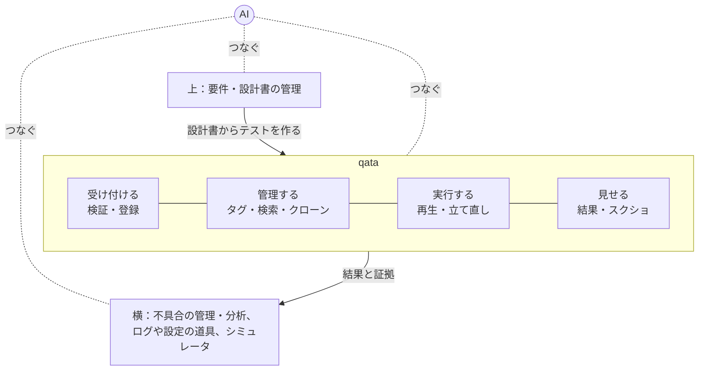

# 構想

qata が最終的に目指す全体像です。**今回すべては作りません。** 今回作る範囲は [scope.md](scope.md) を見てください。

この文書は全体像を理解するためのものです。ここにあるだけで今回のスコープにないものに備えて、抽象化・フォルダ・コードを作ることはしません。

## 目標

テストの担当者が使い、AI が自律して動作確認まで回せること。テストケースは AI が作るのを基本にし、人が作ったり直したりもできる。

## qata の範囲

qata は、テストを受け付けて、管理して、実行して、結果を見せるところまで（D39）。判断は外（AI）で行い、道具は判断しない。

| 置き場所 | 何をするか |
| --- | --- |
| qata の本体 | 受け付ける（形式の検証・部品の辞書との照合・登録）、管理する（タグ・有効な版・検索・クローン）、実行する（再生・止まったときの立て直し）、見せる（結果・スクショ） |
| 切り出す道具 | 設定（ファイル・許可されたレジストリ）を変えて再起動する、設定が正しいかを確かめる、ログを集める。runner に頼らない独立したモジュールにする |
| 周辺 | 外部の相手の代わりをするシミュレータの起動と、設定値の切り替え |
| 外（AI か人） | テストケースの中身を考える、ログを読んで次にすることを決める、不具合の現象を書いて報告する |
| いずれ横に広げる | テストケースの検索、不具合（issue）との連携、不具合の分析 |

- 位置づけは、Web やモバイル向けのテスト自動化ツールの、Windows デスクトップアプリ版に近い。難しさの多くは runner（画面の部品の情報が取れない、立て直しが画面の操作になる）に集まる。

## できるようにしたいこと

- 自然言語で要件や手順を入力する。設計書などから、テストケースをまとめて作る
- テストケースを作成し、登録・管理する
- テストを自動で再生する。止まったら立て直して続ける
- 結果をスクショ付きで閲覧できる
- テストの内容が悪ければ自動で修正する
- 不具合があれば、外（AI と道具）でログを採取し、報告を記載する。qata は結果と証拠を引用しやすい形で渡す

## 対象

Windows のデスクトップアプリ。最終的には、店舗などで使う業務端末。

## 使われ方

- 個人の OSS として開発する（ポートフォリオ）。
- 会社で使う場合は、ここから内製で派生させる想定。
