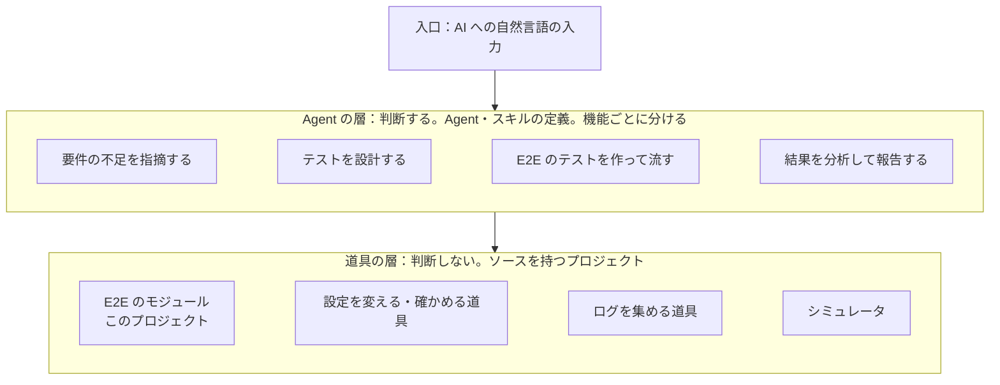

# 構想

このプロジェクトが最終的に目指す姿です。ほとんど変えません。

向かう道筋は中期目標（[roadmap.md](roadmap.md)）に、いまやる範囲は [scope.md](scope.md) に置きます。この文書にあるだけで、いまのスコープにないものに備えて、抽象化・フォルダ・コードを作ることはしません。

## 目標

Windows のデスクトップアプリに対する、E2E のテストを作成・実行・管理するモジュールを完成させる。テストケースは AI が作るのを基本にし、人が作ったり直したりもできる。

### 届いたと言える状態

* AI が MCP でテストケースを渡すと、モジュールが検証して登録する。人も web で作ったり直したりできる。

* テストケースを、タグや有効な版で絞り込み、クローンして使い回せる。

* 登録したテストを流す。止まったら立て直して、続きを流す。

* 結果と証拠（スクショ）を、人が web で見られ、AI が引用しやすい形で受け取れる。

* 電卓のような練習台ではなく、業務アプリの性質（[app-traits.md](knowledge/app-traits.md)）を持つアプリで、これが回る。

## 位置づけ

このモジュールは、QA の活動を AI で支える仕組みの全体のうち、道具の層の一つです。全体はこのプロジェクトのゴールではありません。このモジュールがどこに置かれるかを示すために書きます。

| 層        | 中身                           | 確かめ方                 |
| -------- | ---------------------------- | -------------------- |
| 入口       | AI への自然言語の入力                 | —                    |
| Agent の層 | 判断をする。Agent・スキルの定義で、機能ごとに分ける | 答えの分かっている問題を解かせて確かめる |
| 道具の層     | 判断しない。ソースを持ち、それぞれが独立したプロジェクト | テストなどの関門で、機械的に確かめる   |

* 判断は Agent の層で行い、道具は判断しない（[decisions.md](decisions.md) の D39）。

* 製品の Agent（使う人のためのもの）は、このプロジェクトを作るための Agent やスキル（`.claude/`）とは分けて置く。

* 層の分け方は仮です。Agent の分け方と置き場所（[ideas.md](ideas.md)）と、名前（[qata#44](https://github.com/masakazu2025/qata/issues/44)）は、まだ決めていません。

## 範囲

このモジュールは、テストを受け付けて、管理して、実行して、結果を見せるところまで。

|  | 何をするか                                                                    |
| ------ | ------------------------------------------------------------------------ |
| 受け付ける  | 形式の検証・部品の辞書との照合・登録                                                       |
| 管理する   | タグ・有効な版・検索・クローン                                                          |
| 実行する   | 再生・止まったときの立て直し                                                           |
| 見せる    | 結果・スクショ。人には web で、AI には引用しやすい形で                                          |
| 範囲の外   | テストケースの中身を考える・直す、ログを読んで次にすることを決める、不具合の報告を書く（Agent の層）。設定・ログ・シミュレータ（別の道具） |

位置づけは、Web やモバイル向けのテスト自動化ツールの、Windows デスクトップアプリ版に近い。難しさの多くは runner（画面の部品の情報が取れない、立て直しが画面の操作になる）に集まる。

## 対象

Windows のデスクトップアプリ

## 使われ方

* 個人の OSS として開発する（ポートフォリオ）
